<h1>
IF2150 REKAYASA PERANGKAT LUNAK
 
TUGAS 10
 
HASIL IMPLEMENTASI DAN UJI PERANGKAT LUNAK (HIUPL)
</h1>
 

## *Antri.in*
 

### Untuk: *Angel*

Dipersiapkan oleh:
| Informasi | Keterangan |
| --- | --- |
| Kelas | *01* |
| Kelompok | *10*  |

| NIM | Nama |
|---|---|
| *13525145* | *Muhammad Nur Fikri Hariyawan* |
| *13525085* | *Bayu Palamarta Wirawan*       |
| *13525133* | *Chatima Anandakhorita*        |
| *13525148* | *Athallah Nanda Andita*        |
| *13525091* | *Muhammad Fauzi Muharam*       |

---

## Daftar Isi

- [BAB 1: Pendahuluan](#bab-1-pendahuluan)
  - [1.1 Tujuan Penulisan Dokumen](#11-tujuan-penulisan-dokumen)
  - [1.2 Lingkup Masalah](#12-lingkup-masalah)
  - [1.3 Definisi, Istilah, dan Singkatan](#13-definisi-istilah-dan-singkatan)
  - [1.4 Aturan Penomoran](#14-aturan-penomoran)
  - [1.5 Referensi](#15-referensi)
  - [1.6 Deskripsi Umum Dokumen (Ikhtisar)](#16-deskripsi-umum-dokumen-ikhtisar)
- [BAB 2: Deskripsi Umum Perangkat Lunak](#bab-2-deskripsi-umum-perangkat-lunak)
- [BAB 3: Implementasi](#bab-3-implementasi)
  - [3.1 Lingkungan Implementasi](#31-lingkungan-implementasi)
  - [3.2 Implementasi Modul](#32-implementasi-modul)
  - [3.3 Implementasi Antarmuka](#33-implementasi-antarmuka)
  - [3.4 File Lain](#34-file-lain)
- [BAB 4: Hasil Pengujian](#bab-4-hasil-pengujian)
  - [4.1 Strategi dan Kedalaman Pengujian Kelas](#41-strategi-dan-kedalaman-pengujian-kelas)
  - [4.2 Pengujian Unit Kelas](#42-pengujian-unit-kelas)
  - [4.3 Pengujian Integrasi](#43-pengujian-integrasi)
  - [4.4 Pengujian Use Case](#44-pengujian-use-case)
  - [4.5 Pengujian Kebutuhan Non-Fungsional (KNF)](#45-pengujian-kebutuhan-non-fungsional-knf)
  - [4.6 Tangkapan Layar dan Bukti Hasil Pengujian](#46-tangkapan-layar-dan-bukti-hasil-pengujian)
- [BAB 5: Traceability](#bab-5-traceability)

---

## Daftar Perubahan

| Revisi | Deskripsi |
| :--- | :--- |
| *A* | *Deskripsikan perubahan yang dilakukan dari dokumen sebelumnya pada dokumen ini. Jika tidak terdapat perubahan, harap kosongkan tabel.* |
| *B* |  |
| *C* |  |
| ... |  |

---

# BAB 1: Pendahuluan

## 1.1 Tujuan Penulisan Dokumen
Dokumen Hasil Implementasi dan Uji Perangkat Lunak (HIUPL) ini bertujuan untuk melaporkan hasil implementasi dan pengujian perangkat lunak antri.in, yaitu sistem pemesanan makanan viral dengan antrean digital berbasis web. Dokumen ini memuat informasi mengenai lingkungan implementasi, modul/kelas dan antarmuka yang telah diimplementasikan, hasil pengujian unit, integrasi, use case, dan kebutuhan non-fungsional, serta matriks kerunutan yang memetakan kebutuhan fungsional ke implementasi dan pengujiannya. Target pembaca dokumen ini adalah tim pengembang (kelompok Ducklings), asisten dosen, dan dosen mata kuliah IF2150 Rekayasa Perangkat Lunak.

## 1.2 Lingkup Masalah
Fenomena makanan viral memicu antrean panjang berjam-jam yang membebani pelanggan, karena mereka harus datang lebih awal, menunggu di lokasi, dan mengantre tanpa informasi stok menu maupun estimasi waktu tunggu, ditambah proses pemesanan dan pembayaran di kasir yang memakan waktu 2-5 menit per transaksi. Aplikasi pesan-antar seperti GoFood, GrabFood, dan ShopeeFood pun hanya berfokus pada pengantaran dan tidak membatasi kuota transaksi per rentang waktu, sehingga restoran kewalahan saat pesanan online dan pelanggan fisik datang bersamaan. Celah utamanya adalah belum adanya integrasi antara pemantauan antrean real-time, pengaturan slot waktu, serta pemesanan dan pembayaran awal, sehingga antri.in hadir untuk menghapus waktu berpikir di kasir, meratakan kedatangan pelanggan berbasis kuota jam, dan memberi kebebasan bagi konsumen selama menunggu. Dari fenomena tersebut perangkat lunak bernama antri.in yang akan kami kembangkan merupakan sistem pemesanan makanan viral dengan antrean digital berbasis web yang bertujuan agar pengguna tidak perlu mengantri secara langsung pada restoran. Sistem ini memungkinkan pengguna untuk mencari restoran makanan viral, melihat informasi makanan dan restoran, melakukan pemesanan, memantau antrean dan estimasi pesanan akan selesai, serta fitur booking tempat jika pengguna memutuskan untuk dine-in. Cara kerja dari aplikasi berbasis web ini adalah pertama pengguna memilih restoran yang tersedia, kemudian pengguna dapat membaca informasi mengenai makanan yang terdapat di restoran tersebut. Jika sudah, pengguna dapat memilih makanan yang akan dibeli dan lanjut ke proses pembayaran. Ketika pengguna sudah membayar, barulah akan mendapatkan nomor antrian dan estimasi pesanan selesai sehingga pengguna dapat memperkirakan waktu kedatangan.

## 1.3 Definisi, Istilah, dan Singkatan
Semua definisi dan singkatan yang digunakan dalam dokumen ini beserta penjelasannya.

Tabel 1.3. Definisi Istilah dan Singkatan

| Singkatan, Akronim, atau Istilah | Penjelasan |
| :--- | :--- |
| *P/L* | *Singkatan dari Perangkat Lunak, yaitu aplikasi yang memberikan perintah kepada komputer untuk menjalankan tugas tertentu.* |
| *SKPL* | *Singkatan dari Spesifikasi Kebutuhan Perangkat Lunak, yaitu dokumen yang merangkum kriteria-kriteria yang diperlukan untuk membangun aplikasi menjalankan tugasnya.* |
| *DPPL* | *Singkatan dari Deskripsi Perancangan Perangkat Lunak, yaitu dokumen yang menjelaskan rancangan arsitektur, kelas, dan antarmuka P/L.* |
| *HIUPL* | *Singkatan dari Hasil Implementasi dan Uji Perangkat Lunak, yaitu dokumen yang melaporkan hasil implementasi dan pengujian P/L.* |
| *KF* | *Singkatan dari Kebutuhan Fungsional.* |
| *KNF* | *Singkatan dari Kebutuhan Non-Fungsional.* |
| *UC* | *Singkatan dari Use Case.* |
| *TC* | *Singkatan dari Test Case, yaitu satu kasus uji untuk skenario tertentu.* |
| *UT* | *Singkatan dari Unit Test, yaitu test case tingkat kelas/operasi.* |
| *INT* | *Singkatan dari Integration Test, yaitu test case yang menguji interaksi antarkomponen.* |
| *Boundary* | *Kasus uji pada nilai batas masukan, misalnya nilai minimum, maksimum, atau tepat di ambang aturan.* |
| *Coverage* | *Persentase baris/cabang kode yang dieksekusi oleh pengujian.* |
| *...* | *...* |

## 1.4 Aturan Penomoran
Tuliskan aturan penomoran (ID) yang digunakan dalam dokumen ini. Gunakan pola ID yang **sama** dengan yang sudah dipakai pada dokumen-dokumen sebelumnya (SKPL, APL, DPPL), kecuali untuk ID pengujian yang baru diperkenalkan pada dokumen ini.

Tabel 1.4. Aturan Penomoran

| Hal/Bagian | Penomoran | Keterangan |
| :--- | :--- | :--- |
| *Kebutuhan Fungsional* | *KFXX* | *Sesuai SKPL* |
| *Kebutuhan Non-Fungsional* | *KNFXX* | *Sesuai SKPL* |
| *Use Case* | *UCXX* | *Sesuai SKPL* |
| *Kelas* | *CXX* | *Sesuai DPPL* |
| *Antarmuka* | *I-XX* | *Sesuai DPPL* |
| *Test Case Unit* | *CXX-UTYY* | *XX adalah nomor kelas, YY adalah nomor urut test case unit pada kelas tersebut* |
| *Test Case Integrasi* | *INT-TCYY* | *YY adalah nomor urut test case integrasi* |
| *Test Case Use Case* | *UCXX-TCYY* | *XX adalah nomor use case, YY adalah nomor urut test case pada use case tersebut* |
| *Test Case KNF* | *KNFXX-TCYY* | *XX adalah nomor KNF, YY adalah nomor urut test case pada KNF tersebut* |
| *...* | *...* | *...* |

## 1.5 Referensi
Cantumkan daftar buku, panduan, atau dokumentasi lain yang dirujuk dalam pembuatan dokumen dan pengembangan P/L, **minimal dokumen SKPL, APL, DPPL, dan Implementasi (Tugas 9)**. Tambahkan dokumentasi *framework*/*library*/*testing tool* atau referensi lain apabila digunakan.

## 1.6 Deskripsi Umum Dokumen (Ikhtisar)
Dokumen ini disusun dalam lima bab. Bab 1 berisi pendahuluan yang mencakup tujuan penulisan dokumen, lingkup masalah, definisi dan singkatan, aturan penomoran, referensi, serta ikhtisar dokumen. Bab 2 memaparkan deskripsi umum perangkat lunak antri.in beserta konteks, batasan, dan keterkaitannya dengan sistem eksternal, dilengkapi use case diagram. Bab 3 menjelaskan implementasi, yaitu lingkungan implementasi, daftar modul/kelas, daftar antarmuka, dan file lain yang dihasilkan, serta perubahannya terhadap rancangan pada DPPL. Bab 4 melaporkan hasil pengujian pada tingkat unit, integrasi, use case, dan kebutuhan non-fungsional beserta buktinya. Bab 5 menyajikan matriks kerunutan (traceability) yang memetakan KF, KNF, use case, kelas, file implementasi, dan test case.
 

---

# BAB 2: Deskripsi Umum Perangkat Lunak

Bagian ini diisi dengan *System Overview*, dalam bentuk gambar dan narasi yang memberikan gambaran tentang aplikasi dan konteksnya. **Batasan dan keterkaitan** antara sistem yang dibangun dengan sistem lain di luarnya harus jelas. Deskripsi umum sistem perlu dilengkapi dengan pemodelan kasus yang dihadapi, seperti *use case diagram*. Berikan narasi yang jelas untuk setiap gambar yang ditampilkan.

Bagian ini dapat menyalin atau meringkas dari dokumen SKPL atau DPPL.

## Gambaran Sistem

antri.in adalah aplikasi berbasis web untuk pemesanan makanan viral dengan antrean digital. Pelanggan tidak perlu mengantre secara fisik di restoran. Pelanggan mencari restoran viral, melihat menu dan status antrean, memesan (dine-in, takeaway/pre-order, atau booking tempat), membayar secara digital, lalu menerima nomor antrean beserta estimasi waktu tunggu. Nomor antrean hanya diterbitkan setelah pembayaran lunas.

Sistem melayani tiga aktor dengan hak akses berbeda:

- **Pelanggan**: mencari restoran, memesan dan membayar, memantau status antrean, serta menyampaikan keluhan.
- **Restoran**: mendaftar sebagai mitra, mengelola antrean (dequeue), kuota antrean dan meja, serta menu dan stok.
- **Admin**: memverifikasi pendaftaran mitra, menanggapi keluhan, dan menghapus restoran yang melanggar ketentuan.

Registrasi, login, dan logout tersedia untuk ketiga aktor.

## Batasan dan Keterkaitan dengan Sistem Lain

Sistem dirancang dengan arsitektur MVC. Lapisan View berjalan di browser Google Chrome. Lapisan Controller dan Model berjalan pada server aplikasi (localhost, Windows 11) berbasis TypeScript dan REST API. Seluruh data transaksional dan operasional disimpan pada basis data PostgreSQL 15+ yang berada di lingkungan sistem sendiri.

Dua sistem eksternal berada di luar batas tanggung jawab langsung antri.in:

| Sistem Eksternal | Keterkaitan dengan antri.in | Komponen Penghubung |
| :--- | :--- | :--- |
| *Payment Gateway* | antri.in tidak memproses transaksi sendiri. Sistem mengirim permintaan transaksi saat checkout dan menerima status lunas, gagal, atau kedaluwarsa untuk menentukan penerbitan tiket antrean dan ID pesanan. | `PaymentGatewayAdapter` dan `MetodePembayaranController` (C07) |
| *Layanan Email* | Sistem mengirim email hasil verifikasi pendaftaran mitra (diterima atau ditolak) ke alamat email restoran. | `NotifikasiEmail` (C15) |

## Pemodelan Use Case

Sistem memiliki 15 use case (UC01–UC15) yang memetakan KF01–KF21.

Tabel 2.1. Daftar Use Case antri.in

| ID UC | Nama Use Case | Aktor | ID KF |
| :--- | :--- | :--- | :--- |
| UC01 | Mencari dan filter resto | Pelanggan | KF01, KF02 |
| UC02 | Melakukan pemesanan dan pembayaran digital | Pelanggan | KF05–KF13 |
| UC03 | Menampilkan status antrean | Pelanggan | KF03 |
| UC04 | Pendaftaran mitra restoran baru | Restoran | KF14 |
| UC05 | Memverifikasi pendaftaran restoran | Admin | KF15, KF16 |
| UC06 | Mengelola antrean | Restoran | KF04 |
| UC07 | Mengatur kuota antrean dan meja | Restoran | KF17, KF18 |
| UC08 | Mengelola stok dan menu makanan | Restoran | KF07 |
| UC09 | Menampilkan dashboard antrean restoran | Restoran | KF13 |
| UC10 | Registrasi akun | Pelanggan, Restoran, Admin | KF21 |
| UC11 | Login akun | Pelanggan, Restoran, Admin | KF21 |
| UC12 | Keluar akun | Pelanggan, Restoran, Admin | KF21 |
| UC13 | Penyampaian keluhan pelanggan | Pelanggan | KF19 |
| UC14 | Penanggapan keluhan pelanggan | Admin | KF19 |
| UC15 | Penghapusan restoran | Admin | KF20 |

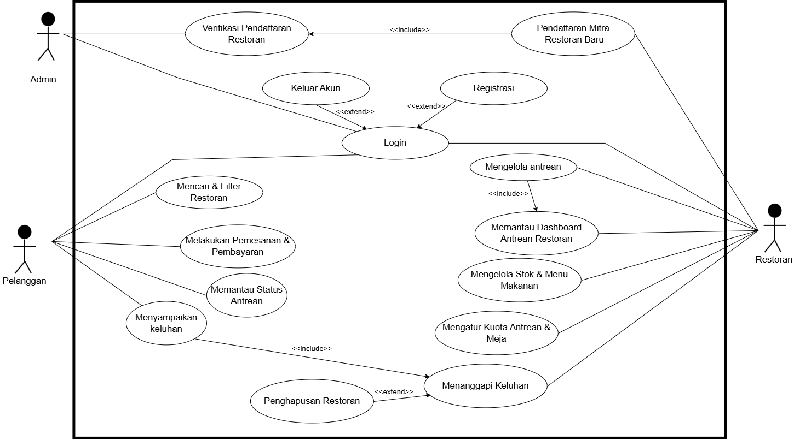

<i>Gambar 2.1. Use Case Diagram antri.in</i>

 

---

# BAB 3: Implementasi

Bagian ini diisi dengan informasi tentang elemen P/L yang dikembangkan (*executable files*, *configuration files*, *data files*, dan sebagainya) serta perubahannya terhadap rancangan pada DPPL (jika ada).

## 3.1 Lingkungan Implementasi

Tuliskan *hardware* dan *software* yang digunakan untuk implementasi, mencakup *operating system*, bahasa pemrograman beserta versinya, *framework*/*library*, DBMS, *development tools*, dan *version control*. Lingkungan ini harus konsisten dengan **Subbab 2.1 DPPL**; jelaskan jika ada perubahan. Cantumkan juga *framework* dan alat pengujian yang dipakai.

Tabel 3.1. Lingkungan Implementasi

| Aspek | Keterangan |
| :--- | :--- |
| *Hardware* | *[Spesifikasi perangkat keras]* |
| *Operating System* | *Windows 11* |
| *Bahasa Pemrograman* | *Typescript 7.0.2* |
| *Framework/Library* | *Node.js 20 LTS, Express 4.22.3, bcryptjs 3.0.3* |
| *DBMS* | *PostgreSQL 15+* |
| *Development Tools* | *Visual Studio Code, GitHub* |
| *Testing Tools* | *`node:test` (`npm test`, `npm run test:pg` untuk PostgreSQL), `npm run profile` (`performance.now()` dan `EXPLAIN ANALYZE`), middleware `Server-Timing` untuk waktu respons API, [isi: Chrome DevTools dan alat coverage yang dipakai]* |

## 3.2 Implementasi Modul

Daftar modul/kelas yang **TELAH** diimplementasikan. Gunakan nama dan ID kelas yang sama dengan DPPL, dan konsisten dengan Tabel B.5 pada dokumen Implementasi (Tugas 9).

Tabel 3.2. Implementasi Modul

| No | ID Kelas | Nama Modul/Kelas | Nama File Fisik | Nama File Executable |
| :--- | :--- | :--- | :--- | :--- |
| 1 | C01 | Pelanggan | `src/server/models/akun.ts` | - |
| 2 | C02 | Restoran | `src/server/models/restoran.ts` | - |
| 3 | C03 | Menu | `src/server/models/menu.ts` | - |
| 4 | C04 | Antrean | `src/server/models/antrean.ts` | - |
| 5 | C05 | Keranjang | `src/client/models/keranjang.ts` | - |
| 6 | C06 | Pesanan | `src/server/models/pesanan.ts` | - |
| 7 | C07 | MetodePembayaranController | `src/server/controllers/metodePembayaranController.ts`, `src/server/models/pembayaran.ts` | - |
| 8 | C08 | RiwayatTransaksi | `src/server/models/pembayaran.ts` | - |
| 9 | C09 | TiketAntrean | `src/server/models/antrean.ts` | - |
| 10 | C10 | PemantauAntreanController | `src/server/controllers/pemantauAntreanController.ts`, `src/server/realtime/eventBus.ts` | - |
| 11 | C11 | HalamanStatusAntrean | `src/client/views/statusAntreanView.ts` | - |
| 12 | C12 | PengajuanMitraController | `src/server/controllers/pengajuanMitraController.ts` | - |
| 13 | C13 | DokumenVerifikasi | `src/server/models/mitra.ts` | - |
| 14 | C14 | Admin | `src/server/models/akun.ts` | - |
| 15 | C15 | NotifikasiEmail | `src/server/adapters/notifikasiEmail.ts` | - |
| 16 | C16 | KelolaAntreanController | `src/server/controllers/kelolaAntreanController.ts` | - |
| 17 | C17 | KonfirmasiDequeuePage | `src/client/core/ui.ts` (`konfirmasi`) | - |
| 18 | C18 | KelolaAntreanPage | `src/client/views/kelolaAntreanView.ts` | - |
| 19 | C19 | DashboardAntreanPage | `src/client/views/kelolaAntreanView.ts` | - |
| 20 | C20 | Kuota | `src/server/models/kuota.ts` | - |
| 21 | C21 | PengaturanKuotaController | `src/server/controllers/pengaturanKuotaController.ts` | - |
| 22 | C22 | PengaturanKuotaPage | `src/client/views/pengaturanKuotaView.ts` | - |
| 23 | C23 | PengaturanMenuPage | `src/client/views/pengaturanMenuView.ts` | - |
| 24 | C24 | KelolaMenuController | `src/server/controllers/kelolaMenuController.ts` | - |
| 25 | C25 | Pengguna | `src/server/models/akun.ts` | - |
| 26 | C26 | HalamanProfilPage | `src/client/views/akunView.ts` | - |
| 27 | C27 | KonfirmasiLogoutPage | `src/client/core/ui.ts` (`konfirmasi`) | - |
| 28 | C28 | AutentikasiController | `src/server/controllers/autentikasiController.ts` | - |
| 29 | C29 | SesiPengguna | `src/server/models/akun.ts`, `src/server/middleware/auth.ts` | - |
| 30 | C30 | Keluhan | `src/server/models/keluhan.ts` | - |
| 31 | C31 | DashboardKelolaRestoranPage | `src/client/views/kelolaRestoranView.ts` | - |
| 32 | C32 | KonfirmasiHapusRestoranPage | `src/client/core/ui.ts` (`konfirmasi`) | - |
| 33 | C33 | KelolaDataRestoranController | `src/server/controllers/kelolaDataRestoranController.ts` | - |
| 34 | C34 | PencarianRestoPage | `src/client/views/pencarianView.ts` | - |
| 35 | C35 | PencarianController | `src/server/controllers/pencarianController.ts` | - |
| 36 | C36 | VerifikasiRestoranPage | `src/client/views/mitraView.ts` | - |
| 37 | C37 | RegistrasiRestoPage | `src/client/views/mitraView.ts` | - |
| 38 | C38 | RegistrasiPage | `src/client/views/akunView.ts` | - |
| 39 | C39 | LoginPage | `src/client/views/akunView.ts` | - |
| 40 | C40 | KeluhanFormPage | `src/client/views/keluhanView.ts` | - |
| 41 | C41 | KeluhanController | `src/server/controllers/keluhanController.ts` | - |
| 42 | C42 | KeluhanDashboardPage | `src/client/views/keluhanView.ts` | - |

## 3.3 Implementasi Antarmuka

Daftar antarmuka yang telah diimplementasikan. Gunakan ID dan nama layar yang sama dengan ID dan nama layar pada tugas DPPL.

Tabel 3.3. Implementasi Antarmuka

| No | ID Antarmuka | Nama Antarmuka | Nama File Fisik | Nama File Executable |
| :--- | :--- | :--- | :--- | :--- |
| 1 | I-01 | Registrasi Akun | `src/client/views/akunView.ts` (`registrasiPage`) | `src/public/index.html` |
| 2 | I-02 | Login | `src/client/views/akunView.ts` (`loginPage`) | `src/public/index.html` |
| 3 | I-03 | Profil Akun | `src/client/views/akunView.ts` (`halamanProfilPage`) | `src/public/index.html` |
| 4 | I-04 | Dialog Konfirmasi Keluar | `src/client/core/ui.ts` (`konfirmasi`), dipanggil dari `akunView.ts` | `src/public/index.html` |
| 5 | I-05 | Beranda & Pencarian Restoran | `src/client/views/pencarianView.ts` (`pencarianRestoPage`), `src/client/views/komponen.ts` | `src/public/index.html` |
| 6 | I-06 | Detail Restoran & Menu | `src/client/views/pencarianView.ts` (`detailRestoranPage`) | `src/public/index.html` |
| 7 | I-07 | Keranjang & Mode Layanan | `src/client/views/pemesananView.ts` | `src/public/index.html` |
| 8 | I-08 | Pilih Jadwal Booking | `src/client/views/pemesananView.ts` | `src/public/index.html` |
| 9 | I-09 | Pembayaran | `src/client/views/pembayaranView.ts` | `src/public/index.html` |
| 10 | I-10 | Tiket Antrean | `src/client/views/pembayaranView.ts` (`tiketPage`) | `src/public/index.html` |
| 11 | I-11 | Status Antrean | `src/client/views/statusAntreanView.ts` (`halamanStatusAntrean`) | `src/public/index.html` |
| 12 | I-12 | Formulir Keluhan | `src/client/views/keluhanView.ts` (`keluhanFormPage`) | `src/public/index.html` |
| 13 | I-13 | Pendaftaran Mitra | `src/client/views/mitraView.ts` (`registrasiRestoPage`) | `src/public/index.html` |
| 14 | I-14 | Dashboard & Kelola Antrean | `src/client/views/kelolaAntreanView.ts` (`dashboardAntreanPage`) | `src/public/index.html` |
| 15 | I-15 | Dialog Konfirmasi Dequeue | `src/client/core/ui.ts` (`konfirmasi`), dipanggil dari `kelolaAntreanView.ts` | `src/public/index.html` |
| 16 | I-16 | Pengaturan Kuota & Meja | `src/client/views/pengaturanKuotaView.ts` | `src/public/index.html` |
| 17 | I-17 | Pengaturan Menu & Stok | `src/client/views/pengaturanMenuView.ts` | `src/public/index.html` |
| 18 | I-18 | Verifikasi Pengajuan Mitra | `src/client/views/mitraView.ts` (`verifikasiRestoranPage`) | `src/public/index.html` |
| 19 | I-19 | Daftar Keluhan | `src/client/views/keluhanView.ts` (`keluhanDashboardPage`) | `src/public/index.html` |
| 20 | I-20 | Kelola Restoran Mitra | `src/client/views/kelolaRestoranView.ts` (`dashboardKelolaRestoranPage`) | `src/public/index.html` |
| 21 | I-21 | Dialog Konfirmasi Hapus Restoran | `src/client/core/ui.ts` (`konfirmasi`), dipanggil dari `kelolaRestoranView.ts` | `src/public/index.html` |

## 3.4 File Lain

Daftar file lain yang dibuat selain file kelas dan antarmuka, misalnya file *utility*, *configuration*, *database schema/seed*, *file test*, atau *data*.

Tabel 3.4. File Lain

| No | Nama File | Keterangan |
| :--- | :--- | :--- |
| 1 | `src/package.json`, `src/package-lock.json` | Dependensi dan skrip npm (`start`, `dev`, `test`, `test:pg`, `profile`) |
| 2 | `src/tsconfig.json`, `src/tsconfig.client.json` | Konfigurasi TypeScript untuk server/test dan klien |
| 3 | `src/.env.example`, `src/.gitignore` | Contoh environment variable tanpa nilai rahasia, dan daftar berkas yang tidak di-commit (`node_modules/`, `data/`, `uploads/`, `.env`, `public/js/`) |
| 4 | `src/server/config.ts` | Konfigurasi aturan bisnis (timeout pembayaran, dequeue otomatis, kuota, biaya layanan) |
| 5 | `src/server/context.ts` | Tipe dependensi bersama controller dan pengguna yang login |
| 6 | `src/server/utils/errors.ts`, `ids.ts`, `validasi.ts`, `unggah.ts` | Utilitas error HTTP, pembuat ID dan nomor antrean, validasi umum, unggah gambar |
| 7 | `src/server/middleware/auth.ts`, `errorHandler.ts`, `timing.ts` | Validasi token dan peran, penanganan error, header `Server-Timing` |
| 8 | `src/server/routes/*.ts` (`util`, `autentikasi`, `pencarian`, `menu`, `pemesanan`, `pembayaran`, `antrean`, `mitra`, `keluhan`, `ulasan`, `notifikasi`, `profilRestoran`, `simulasi`) | Definisi endpoint REST API per modul |
| 9 | `src/server/db/schema.sql` | Skema basis data (17 tabel) dan indeks |
| 10 | `src/server/db/seed.ts`, `src/server/db/seed-cli.ts` | Data contoh fiktif dan akun uji (`npm run seed`) |
| 11 | `src/docker-compose.yml` | PostgreSQL 16 lokal (opsional) |
| 12 | `src/client/core/html.ts`, `api.ts`, `konfigurasi.ts`, `session.ts` | Template HTML aman, pemanggil REST dan SSE, konfigurasi klien, penyimpanan token |
| 13 | `src/client/views/layout.ts` | Navbar pelanggan dan sidebar restoran/admin |
| 14 | `src/public/css/style.css`, `src/public/img/logo.png`, `src/public/img/favicon.svg` | Gaya tampilan dan aset gambar |
| 15 | `src/scripts/profile-dashboard.ts` | Skrip profiling dashboard antrean (`npm run profile`) |
| 16 | `src/tests/helpers.ts` | Helper pengujian bersama (aplikasi uji, login) |
| 17 | `src/tests/autentikasi.test.ts` | Test UC10–UC12 |
| 18 | `src/tests/pencarian.test.ts` | Test UC01 |
| 19 | `src/tests/pemesanan.test.ts`, `src/tests/keranjang.test.ts` | Test UC02 bagian pemesanan dan unit test `Keranjang` |
| 20 | `src/tests/pembayaran.test.ts` | Test pembayaran dan AntriPay Sandbox |
| 21 | `src/tests/antrean.test.ts` | Test UC03, UC06, UC07, UC09 |
| 22 | `src/tests/menu.test.ts` | Test UC08 |
| 23 | `src/tests/mitra.test.ts` | Test UC04, UC05 |
| 24 | `src/tests/keluhan.test.ts` | Test UC13–UC15 |
| 25 | `src/tests/ulasan.test.ts`, `notifikasi.test.ts`, `profilRestoran.test.ts`, `simulasi.test.ts` | Test fitur tambahan |
| 26 | `src/tests/api.test.ts` | Test hak akses REST API |

 

---

# BAB 4: Hasil Pengujian

Bab ini melaporkan hasil pengujian P/L pada level unit, integrasi, dan sistem. Pengujian dilakukan pada tag release terakhir Tugas 9. Hasil aktual diisi berdasarkan pengamatan saat pengujian. Kesimpulan diisi `Pass` atau `Fail`, dan untuk `Fail` dilengkapi penyebab serta usulan perbaikan.

## 4.1 Strategi dan Kedalaman Pengujian Kelas

Setiap kelas perancangan pada Tabel 4.1 DPPL diklasifikasikan ke dalam tiga tingkat kedalaman pengujian. Tingkat **Mendalam** diberikan pada kelas yang memuat logika bisnis, perhitungan, validasi, aturan status, algoritma, integrasi eksternal, atau keamanan. Tingkat **Sedang** diberikan pada kelas yang hanya mengoordinasikan atau mendelegasikan proses. Tingkat **Tidak perlu** diberikan pada kelas tanpa logika, seperti *entity/DTO* dan kelas konfigurasi, yang teruji secara tidak langsung melalui test case use case. Seluruh kelas wajib dicantumkan beserta alasan penentuan tingkatnya.

Tabel 4.1.1. Identifikasi Tingkat Pengujian Kelas

| ID Kelas | Nama Kelas | Tingkat | Alasan | Test Case Terkait |
| :--- | :--- | :--- | :--- | :--- |
| C01 | Pelanggan | Sedang | Hanya mendelegasikan `accountRegister()` ke AutentikasiController dan menyimpan profil, serta `getDetails()` berupa pembacaan data | C01-UT01 s.d. C01-UT03 |
| C02 | Restoran | Mendalam | Memuat aturan status aktif (`getDetailRestoran()` hanya restoran aktif), pencarian, `setSoftDelete()`, dan pembersihan data (`purgeData()`) | C02-UT01 s.d. C02-UT10 |
| C03 | Menu | Mendalam | Memuat validasi harga dan stok, `isTersedia()`, `kurangiStok()` yang atomik dan tidak boleh negatif, serta soft delete | C03-UT01 s.d. C03-UT11 |
| C04 | Antrean | Mendalam | Memuat algoritma dequeue, penentuan tiket terdepan, estimasi waktu tunggu (median waktu layanan), dan pembaruan status antrean | C04-UT01 s.d. C04-UT08 |
| C05 | Keranjang | Mendalam | Memuat perhitungan `hitungTotal()` dan aturan tambah/hapus item (jumlah item yang sama digabung) | C05-UT01 s.d. C05-UT11 |
| C06 | Pesanan | Mendalam | Memuat validasi booking (maksimal 7 hari, kapasitas meja per slot), transisi status pesanan, dan pembatalan yang hanya berlaku untuk status tertentu | C06-UT01 s.d. C06-UT12 |
| C07 | MetodePembayaranController | Mendalam | Integrasi eksternal ke Payment Gateway, batas waktu pembayaran, verifikasi lunas, pencegahan double-charge, dan pembatalan saat timeout | C07-UT01 s.d. C07-UT13 |
| C08 | RiwayatTransaksi | Sedang | Hanya mencatat transaksi lunas dan membaca bukti pembayaran, dipanggil oleh MetodePembayaranController | C08-UT01 s.d. C08-UT03 |
| C09 | TiketAntrean | Mendalam | Memuat algoritma nomor urut unik per hari (KNF03), estimasi waktu tunggu, dan aturan status final yang tidak boleh diubah | C09-UT01 s.d. C09-UT07 |
| C10 | PemantauAntreanController | Sedang | Hanya mengoordinasikan pembacaan status antrean dan pengiriman pembaruan lewat Server-Sent Events | C10-UT01 s.d. C10-UT04 |
| C11 | HalamanStatusAntrean | Tidak perlu | Kelas boundary yang hanya menampilkan data status antrean dari server. Teruji lewat UC03 | - |
| C12 | PengajuanMitraController | Mendalam | Memuat validasi kelengkapan data, aturan status pengajuan (hanya status menunggu yang dapat disetujui/ditolak), alasan penolakan wajib, dan pemicu email | C12-UT01 s.d. C12-UT10 |
| C13 | DokumenVerifikasi | Mendalam | Memuat validasi format (PDF/JPG/PNG) dan ukuran maksimal 5 MB | C13-UT01 s.d. C13-UT07 |
| C14 | Admin | Sedang | Hanya mendelegasikan `accountRegister()` ke AutentikasiController. Peninjauan pengajuan, keluhan, dan penghapusan dilakukan lewat controller lain | C14-UT01 s.d. C14-UT02 |
| C15 | NotifikasiEmail | Mendalam | Integrasi eksternal: validasi format email, penentuan subjek, pencatatan status kirim (terkirim/gagal) ke `log_notifikasi` | C15-UT01 s.d. C15-UT04 |
| C16 | KelolaAntreanController | Mendalam | Memuat algoritma dequeue dalam transaksi, pembaruan kapasitas, serta timer dequeue otomatis bagi pelanggan yang tidak hadir | C16-UT01 s.d. C16-UT07 |
| C17 | KonfirmasiDequeuePage | Tidak perlu | Kelas boundary berupa dialog konfirmasi tanpa logika bisnis. Teruji lewat UC06 | - |
| C18 | KelolaAntreanPage | Tidak perlu | Kelas boundary yang hanya menampilkan daftar antrean dan membuka dialog. Teruji lewat UC06 | - |
| C19 | DashboardAntreanPage | Tidak perlu | Kelas boundary yang menampilkan antrean dan memuat ulang data. Teruji lewat UC09 | - |
| C20 | Kuota | Mendalam | Memuat perhitungan kapasitas, aturan antrean tutup bila kapasitas habis atau ditutup manual, serta penyimpanan kuota terakhir | C20-UT01 s.d. C20-UT05 |
| C21 | PengaturanKuotaController | Mendalam | Memuat validasi input kuota dan meja (angka, lebih dari 0) serta penyimpanan yang memicu pembaruan kapasitas | C21-UT01 s.d. C21-UT06 |
| C22 | PengaturanKuotaPage | Tidak perlu | Kelas boundary. Validasi dilakukan ulang oleh C21 di server. Teruji lewat UC07 | - |
| C23 | PengaturanMenuPage | Tidak perlu | Kelas boundary berupa daftar dan formulir menu. Validasi berada di C24. Teruji lewat UC08 | - |
| C24 | KelolaMenuController | Mendalam | Memuat validasi nama, harga, dan stok menu, serta alur tambah, ubah, ubah stok, dan hapus menu | C24-UT01 s.d. C24-UT10 |
| C25 | Pengguna | Mendalam | Aspek keamanan: hash kata sandi, pencocokan kredensial, pengecekan duplikasi, dan pengambilan profil | C25-UT01 s.d. C25-UT10 |
| C26 | HalamanProfilPage | Tidak perlu | Kelas boundary yang hanya memicu dialog logout. Teruji lewat UC12 | - |
| C27 | KonfirmasiLogoutPage | Tidak perlu | Kelas boundary berupa dialog konfirmasi tanpa logika. Teruji lewat UC12 | - |
| C28 | AutentikasiController | Mendalam | Aspek keamanan: validasi registrasi (email, kata sandi minimal 8 karakter, duplikasi), penerbitan token sesi, login, dan logout | C28-UT01 s.d. C28-UT10 |
| C29 | SesiPengguna | Mendalam | Aspek keamanan: validasi token, masa berlaku sesi, dan penonaktifan sesi saat logout | C29-UT01 s.d. C29-UT08 |
| C30 | Keluhan | Mendalam | Memuat aturan status keluhan (BARU, DIBACA, DITANGGAPI) dan penyimpanan keluhan | C30-UT01 s.d. C30-UT06 |
| C31 | DashboardKelolaRestoranPage | Tidak perlu | Kelas boundary berupa daftar, pencarian, dan filter restoran. Teruji lewat UC15 | - |
| C32 | KonfirmasiHapusRestoranPage | Tidak perlu | Kelas boundary berupa dialog konfirmasi. Teruji lewat UC15 | - |
| C33 | KelolaDataRestoranController | Mendalam | Memuat aturan penghapusan dalam satu transaksi: soft delete restoran, penonaktifan menu, dan pembatalan antrean/pesanan aktif | C33-UT01 s.d. C33-UT06 |
| C34 | PencarianRestoPage | Tidak perlu | Kelas boundary yang hanya menerima kata kunci/filter dan menampilkan hasil. Teruji lewat UC01 | - |
| C35 | PencarianController | Mendalam | Memuat algoritma pencarian dan penerapan filter (nama, kategori, lokasi, rating) serta pengambilan status antrean dan pratinjau menu | C35-UT01 s.d. C35-UT08 |
| C36 | VerifikasiRestoranPage | Tidak perlu | Kelas boundary yang menampilkan detail pengajuan dan tombol setujui/tolak. Teruji lewat UC05 | - |
| C37 | RegistrasiRestoPage | Tidak perlu | Kelas boundary berupa formulir pendaftaran mitra. Validasi berada di C12 dan C13. Teruji lewat UC04 | - |
| C38 | RegistrasiPage | Tidak perlu | Kelas boundary berupa formulir registrasi. Validasi berada di C28. Teruji lewat UC10 | - |
| C39 | LoginPage | Tidak perlu | Kelas boundary berupa formulir login. Validasi berada di C28. Teruji lewat UC11 | - |
| C40 | KeluhanFormPage | Tidak perlu | Kelas boundary berupa formulir keluhan. Validasi berada di C41. Teruji lewat UC13 | - |
| C41 | KeluhanController | Mendalam | Memuat validasi isi dan kategori keluhan, pencatatan tanggapan admin, dan pembaruan status | C41-UT01 s.d. C41-UT06 |
| C42 | KeluhanDashboardPage | Tidak perlu | Kelas boundary berupa daftar dan detail keluhan. Teruji lewat UC14 | - |

## 4.2 Pengujian Unit Kelas

Pengujian unit dilakukan pada kelas bertingkat Mendalam dan Sedang. Kelas Mendalam diuji pada seluruh operasi public dengan kasus normal, batas, dan negatif, serta mencapai *coverage* minimal 70%. Kelas Sedang diuji minimal dengan satu kasus normal dan satu kasus gagal pada operasi public utama.

Cara menjalankan unit test: *`cd src && npm test`*.

Lokasi file test: *`src/tests/`*.

### 4.2.1 Kelas Pelanggan

**ID Kelas:** C01  
**Nama Kelas:** Pelanggan  
**Tingkat:** Sedang

Tabel 4.2.1. Hasil Pengujian Unit Kelas C01

| ID Pengujian | Operasi yang Diuji | Jenis Kasus | Prosedur/Masukan | Hasil yang Diharapkan | Hasil Pengujian | Kesimpulan | Lokasi Test |
| :--- | :--- | :--- | :--- | :--- | :--- | :--- | :--- |
| C01-UT01 | `accountRegister(data)` | Normal | `autentikasi.test.ts › registrasi, login, dan logout`. Registrasi akun uji lalu login memakai email berhuruf besar. | Akun tersimpan, login berhasil dengan peran PELANGGAN | Akun terbuat dan login berhasil (teruji tidak langsung lewat C28) | Pass | `src/tests/autentikasi.test.ts:30` |
| C01-UT02 | `accountRegister(data)` | Negatif | `autentikasi.test.ts › email/nomor duplikat dan kata sandi lemah ditolak`. Email sudah terdaftar. | Ditolak status 409 | Ditolak 409 | Pass | `src/tests/autentikasi.test.ts:41` |
| C01-UT03 | `getDetails()` (`Pelanggan.getByAkun`) | Normal / Negatif | Daftarkan akun lalu baca profilnya; ID akun `USR-tidak-ada`. | Nama dan email sesuai; akun tidak ada menghasilkan `null` | Sesuai | Pass | `src/tests/autentikasi.test.ts:131` |

### 4.2.2 Kelas Restoran

**ID Kelas:** C02  
**Nama Kelas:** Restoran  
**Tingkat:** Mendalam

Tabel 4.2.2. Hasil Pengujian Unit Kelas C02

| ID Pengujian | Operasi yang Diuji | Jenis Kasus | Prosedur/Masukan | Hasil yang Diharapkan | Hasil Pengujian | Kesimpulan | Lokasi Test |
| :--- | :--- | :--- | :--- | :--- | :--- | :--- | :--- |
| C02-UT01 | `getDetailRestoran(restoranId)` | Normal | `profilRestoran.test.ts › ubah profil memvalidasi jam buka dan alamat`. Ambil detail restoran Bakso. | Detail memuat deskripsi yang baru disimpan | Deskripsi sesuai | Pass | `src/tests/profilRestoran.test.ts:23` |
| C02-UT02 | `getDetailRestoran(restoranId)` | Negatif | `pencarian.test.ts › C35-UT03`. ID `RST-tidak-ada`. Juga `keluhan.test.ts › hapus restoran…` untuk restoran nonaktif. | Galat 404 | 404 pada kedua kasus | Pass | `src/tests/keluhan.test.ts:44` |
| C02-UT03 | `getDaftarMenu(restoranId)` | Normal | `menu.test.ts › C03-UT04`. | Hanya menu aktif yang dikembalikan | Semua menu berstatus aktif | Pass | `src/tests/menu.test.ts:64` |
| C02-UT04 | `Restoran.cari` (dipakai C35) | Normal / Batas | `pencarian.test.ts` (kata kunci menu, rating, lokasi) dan `pencarian.test.ts › C35-UT01, C35-UT02`. | Hasil sesuai filter, kosong bila tidak ada | Sesuai | Pass | `src/tests/pencarian.test.ts:26` |
| C02-UT05 | `setSoftDelete()` | Normal | `keluhan.test.ts › hapus restoran menonaktifkan menu dan membatalkan antrean aktif`. | Restoran nonaktif, tidak muncul di detail (404) | Sesuai | Pass | `src/tests/keluhan.test.ts:44` |
| C02-UT06 | `ajukanPendaftaran()` dan `accountRegister(idAkun)` | Normal | `mitra.test.ts › ajukan -> tolak -> ajukan ulang -> setujui…`. Setujui membuat restoran tertaut ke akun. | Sesi pengguna memuat `restoranId` dan restoran dapat dicari | Sesuai | Pass | `src/tests/mitra.test.ts:36` |
| C02-UT07 | `getPengaturan(restoranId)` | Normal / Negatif | `antrean.test.ts › C20-UT02`. ID ada dan ID `RST-tidak-ada`. | Data kuota, atau `null` | Sesuai | Pass | `src/tests/antrean.test.ts:196` |
| C02-UT08 | `getAntrean()` (`Antrean.getByRestoran`) | Normal / Negatif | Antrean restoran Bakso; ID `RST-tidak-ada`. | Antrean ada; `null` untuk ID tidak ada | Sesuai | Pass | `src/tests/antrean.test.ts:249` |
| C02-UT09 | `purgeData()` (digabung dalam `setSoftDelete()`) | Normal | Dua pesanan aktif (satu lunas, satu menunggu bayar), lalu `hapusDataRestoran()`. | Menu nonaktif dan stok 0, kuota 0, antrean TUTUP dengan total 0, kedua pesanan DIBATALKAN, pembayaran menunggu GAGAL, `dihapus_pada` terisi | Sesuai | Pass | `src/tests/keluhan.test.ts:135` |
| C02-UT10 | `setSoftDelete()` | Normal / Negatif | Panggil `Restoran.setSoftDelete` langsung pada restoran aktif, lalu sekali lagi, dan pada ID tidak ada. | `true` dan restoran tidak tampil; panggilan kedua dan ID tidak ada menghasilkan `false` | Sesuai | Pass | `src/tests/keluhan.test.ts:164` |

Tabel 4.2.2b. Ringkasan Cakupan Kelas C02

| Informasi | Keterangan |
| :--- | :--- |
| Daftar operasi public pada DPPL | `getDetailRestoran()`, `getMenu()`, `getAntrean()`, `ajukanPendaftaran()`, `getPengaturan()`, `getDaftarMenu()`, `showDashboard()`, `accountRegister()`, `setSoftDelete()`, `purgeData()` |
| Operasi yang diuji | `getDetailRestoran()`, `getDaftarMenu()`, `ajukanPendaftaran()`, `getAntrean()`, `getPengaturan()`, `accountRegister()`, `setSoftDelete()`, `purgeData()` (8 dari 10) |
| ID Algoritma yang tercakup | Algo-009, Algo-011, Algo-012, Algo-014, Algo-016, Algo-017 (perkiraan pemetaan, perlu dicocokkan dengan DPPL) |
| Coverage (wajib ≥ 70%) | `models/restoran.ts`: 98,17% baris / 100% *branch*. Bukti pada 4.6. |

### 4.2.3 Kelas Menu

**ID Kelas:** C03  
**Nama Kelas:** Menu  
**Tingkat:** Mendalam

Tabel 4.2.3. Hasil Pengujian Unit Kelas C03

| ID Pengujian | Operasi yang Diuji | Jenis Kasus | Prosedur/Masukan | Hasil yang Diharapkan | Hasil Pengujian | Kesimpulan | Lokasi Test |
| :--- | :--- | :--- | :--- | :--- | :--- | :--- | :--- |
| C03-UT01 | `kurangiStok(jumlah)` | Normal / Batas | Kurangi 1, lalu kurangi sisa stok tepat habis. | Keduanya berhasil, stok akhir 0 | Stok 0 | Pass | `src/tests/menu.test.ts:45` |
| C03-UT02 | `kurangiStok(jumlah)` | Negatif | Kurangi stok + 1. | Mengembalikan `false`, stok tidak berubah dan tidak negatif | `false`, stok tetap | Pass | `src/tests/menu.test.ts:52` |
| C03-UT03 | `isTersedia(jumlah)` | Batas / Negatif | Stok 5 dengan jumlah 5, 6, 0, dan menu nonaktif. | `true`, `false`, `false`, `false` | Sesuai | Pass | `src/tests/menu.test.ts:58` |
| C03-UT04 | `getInfoMenu()` / daftar menu | Normal | Daftar menu restoran Geprek. | Hanya menu aktif | Sesuai | Pass | `src/tests/menu.test.ts:64` |
| C03-UT05 | `tambahMenu()`, `hapusMenu()` | Normal | `menu.test.ts › tambah, ubah stok, dan hapus menu`. Tambah menu lalu hapus. | Menu muncul lalu hilang dari daftar | Sesuai | Pass | `src/tests/menu.test.ts:25` |
| C03-UT06 | `updateStok(stokBaru)` | Batas | Sama dengan C03-UT05, stok diubah ke `'0'`. | Stok = 0 | Stok 0 | Pass | `src/tests/menu.test.ts:25` |
| C03-UT07 | `tambahMenu()` (validasi) | Negatif | Nama `X`, harga `-1`, stok `a`. | Galat 400 pada kolom `harga`, `namaMenu`, `stok` | Ketiga kolom ditolak | Pass | `src/tests/menu.test.ts:25` |
| C03-UT08 | `updateStok()` lintas restoran | Negatif | `menu.test.ts › restoran lain tidak bisa mengubah menu milik restoran lain`. | Galat 404 | 404 | Pass | `src/tests/menu.test.ts:36` |
| C03-UT09 | `getInfoMenu()` | Normal / Negatif | Menu ada; ID `MNU-tidak-ada`. | Menu dikembalikan; `null` untuk ID tidak ada | Sesuai | Pass | `src/tests/menu.test.ts:72` |
| C03-UT10 | `updateInfoMenu()` | Normal / Negatif | Ubah nama, harga 600, stok 3 pada restoran pemilik; coba dari restoran lain. | Perubahan tersimpan; restoran lain mendapat `null` | Sesuai | Pass | `src/tests/menu.test.ts:77` |
| C03-UT11 | `cekStok()` | Normal | Memeriksa operasi `cekStok` pada kelas `Menu` (DPPL C03). | Operasi tersedia | Operasi tidak ada (hanya `isTersedia`) | **Fail** | `src/tests/menu.test.ts:107` |

Penyebab fail: `cekStok()` tidak ada di kode, hanya `isTersedia()` (C03-UT11 Fail).

Tabel 4.2.3b. Ringkasan Cakupan Kelas C03

| Informasi | Keterangan |
| :--- | :--- |
| Daftar operasi public pada DPPL | `getInfoMenu()`, `cekStok()`, `kurangiStok()`, `tambahMenu()`, `updateStok()`, `updateInfoMenu()`, `isTersedia()`, `hapusMenu()` |
| Operasi yang diuji | `getInfoMenu()`, `kurangiStok()`, `tambahMenu()`, `updateStok()`, `updateInfoMenu()`, `isTersedia()`, `hapusMenu()` (7 dari 8; `cekStok()` tidak diimplementasikan) |
| ID Algoritma yang tercakup | Algo-019 s.d. Algo-026 sebagian (perlu dicocokkan) |
| Coverage (wajib ≥ 70%) | `models/menu.ts`: 94,59% baris / 100% *branch* |

### 4.2.4 Kelas Antrean

**ID Kelas:** C04  
**Nama Kelas:** Antrean  
**Tingkat:** Mendalam

Tabel 4.2.4. Hasil Pengujian Unit Kelas C04

| ID Pengujian | Operasi yang Diuji | Jenis Kasus | Prosedur/Masukan | Hasil yang Diharapkan | Hasil Pengujian | Kesimpulan | Lokasi Test |
| :--- | :--- | :--- | :--- | :--- | :--- | :--- | :--- |
| C04-UT01 | `getQueueStatus()` | Normal / Batas | `antrean.test.ts › status antrean dari kuota`. `(0,0)`, `(30,29)`, `(30,30)`. | TUTUP, BUKA, PENUH | Sesuai | Pass | `src/tests/antrean.test.ts:94` |
| C04-UT02 | `getEstimasiWaktu()` | Normal / Negatif | `antrean.test.ts › estimasi waktu tunggu`. `(6,3)` dan `(-1,3)`. | 18 dan 0 | Sesuai | Pass | `src/tests/antrean.test.ts:100` |
| C04-UT03 | `getEstimasiWaktu()` (median) | Batas | `antrean.test.ts › menit per antrean dari median jeda…`. Data kurang, normal, dan terlalu besar. | 3 (bawaan), 5, 15 (maksimum) | Sesuai | Pass | `src/tests/antrean.test.ts:156` |
| C04-UT04 | `dequeueCustomer()`, `updateStatus()` | Normal | `antrean.test.ts › dequeue memanggil pelanggan berikutnya…`. | Antrean aktif berkurang 1, `nomorDilayani`=1, sisa dan estimasi pelanggan berkurang | Sesuai | Pass | `src/tests/antrean.test.ts:41` |
| C04-UT05 | `getFrontCustomer()` | Normal | Pada test yang sama, `daftar[0]` berstatus DIPANGGIL. | Pelanggan terdepan DIPANGGIL | Sesuai | Pass | `src/tests/antrean.test.ts:41` |
| C04-UT06 | `updateStatus()` + notifikasi | Normal | `antrean.test.ts › pelanggan yang dipanggil mendapat notifikasi "Giliranmu"`. | Notifikasi berjudul "Giliranmu…" | Ada | Pass | `src/tests/antrean.test.ts:143` |
| C04-UT07 | `dequeueCustomer()` | Negatif | `antrean.test.ts › restoran tanpa antrean tidak dapat dequeue`. | Galat "Belum ada antrean" | Sesuai | Pass | `src/tests/antrean.test.ts:74` |
| C04-UT08 | `getDetailAntrean()` | Normal / Negatif | Detail antrean restoran Bakso; ID `RST-tidak-ada`. | Hanya tiket MENUNGGU/DIPANGGIL beserta rincian; daftar kosong untuk ID tidak ada | Sesuai | Pass | `src/tests/antrean.test.ts:243` |

Tidak diuji: `getPesananPreOrder`, `updateMenu`.

Tabel 4.2.4b. Ringkasan Cakupan Kelas C04

| Informasi | Keterangan |
| :--- | :--- |
| Daftar operasi public pada DPPL | `getFrontCustomer()`, `getEstimasiWaktu()`, `getDetailAntrean()`, `updateStatus()`, `dequeueCustomer()`, `getPesananPreOrder()`, `getQueueStatus()`, `updateMenu()` |
| Operasi yang diuji | `getFrontCustomer()`, `getEstimasiWaktu()`, `getDetailAntrean()`, `updateStatus()`, `dequeueCustomer()`, `getQueueStatus()` (6 dari 8) |
| ID Algoritma yang tercakup | Algo-027, Algo-028, Algo-030, Algo-031, Algo-033 (perlu dicocokkan) |
| Coverage (wajib ≥ 70%) | `models/antrean.ts` (bersama C09): 98,18% baris / 83,67% *branch* |

### 4.2.5 Kelas Keranjang

**ID Kelas:** C05  
**Nama Kelas:** Keranjang  
**Tingkat:** Mendalam

Tabel 4.2.5. Hasil Pengujian Unit Kelas C05

| ID Pengujian | Operasi yang Diuji | Jenis Kasus | Prosedur/Masukan | Hasil yang Diharapkan | Hasil Pengujian | Kesimpulan | Lokasi Test |
| :--- | :--- | :--- | :--- | :--- | :--- | :--- | :--- |
| C05-UT01 | `tambahItem()`, `hitungTotal()` | Normal | `keranjang.test.ts › tambahItem dan hitungTotal`. M1 25.000 x 2 dan M2 6.000 x 3. | Total = 68.000, total item 5 | Sesuai | Pass | `src/tests/keranjang.test.ts:17` |
| C05-UT02 | `tambahItem()` | Normal | Item sama ditambah dua kali. | Jumlah digabung = 2 | 2 | Pass | `src/tests/keranjang.test.ts:17` |
| C05-UT03 | `tambahItem()` | Batas | `keranjang.test.ts › jumlah per item dibatasi 50…`. Tambah 70. | Jumlah = 50 | 50 | Pass | `src/tests/keranjang.test.ts:44` |
| C05-UT04 | `tambahItem()` | Negatif | Tambah dengan jumlah 0. | Melempar galat | Galat dilempar | Pass | `src/tests/keranjang.test.ts:44` |
| C05-UT05 | `tambahItem()` | Normal | `keranjang.test.ts › menambah dari restoran lain mengosongkan keranjang`. | Hanya item restoran baru | Sesuai | Pass | `src/tests/keranjang.test.ts:27` |
| C05-UT06 | `hapusItem()` / `ubahJumlah(…,0)` | Batas | `keranjang.test.ts › ubahJumlah ke 0 menghapus item…`. | Item hilang, `restoranId` = null | Sesuai | Pass | `src/tests/keranjang.test.ts:36` |
| C05-UT07 | Persistensi (penyimpanan) | Normal | `keranjang.test.ts › keranjang tersimpan dan dimuat ulang…`. | Isi, mode BOOKING, dan rombongan terbaca ulang | Sesuai | Pass | `src/tests/keranjang.test.ts:51` |
| C05-UT08 | `aturMode()` dan muat data rusak | Negatif | `keranjang.test.ts › aturMode non-booking…; data rusak…`. | Jadwal dihapus, data rusak diabaikan | Sesuai | Pass | `src/tests/keranjang.test.ts:62` |
| C05-UT09 | `kosongkanKeranjang()` | Normal | Tambah item lalu kosongkan; muat ulang dari penyimpanan. | Item 0, restoran `null`, penyimpanan ikut kosong | Sesuai | Pass | `src/tests/keranjang.test.ts:72` |
| C05-UT10 | `hitungTotal()` | Negatif | Keranjang tanpa item. | Total = 0 | 0 | Pass | `src/tests/keranjang.test.ts:82` |
| C05-UT11 | `hapusItem()` | Normal / Negatif | Dua item, hapus satu, lalu hapus ID tidak ada. | Sisa satu item, total 12.000, ID tidak ada diabaikan | Sesuai | Pass | `src/tests/keranjang.test.ts:86` |

Seluruh operasi public diuji, termasuk `kosongkanKeranjang()` dan `hitungTotal()` pada keranjang kosong.

Tabel 4.2.5b. Ringkasan Cakupan Kelas C05

| Informasi | Keterangan |
| :--- | :--- |
| Daftar operasi public pada DPPL | `tambahItem()`, `hapusItem()`, `hitungTotal()`, `kosongkanKeranjang()` |
| Operasi yang diuji | `tambahItem()`, `hapusItem()`, `hitungTotal()`, `kosongkanKeranjang()` (4 dari 4) |
| ID Algoritma yang tercakup | Algo-035, Algo-036, Algo-037 |
| Coverage (wajib ≥ 70%) | `client/models/keranjang.ts`: 76,51% baris / 90,00% *branch* (diukur terpisah dengan `--test-coverage-include='client/models/keranjang.ts'`) |

### 4.2.6 Kelas Pesanan

**ID Kelas:** C06  
**Nama Kelas:** Pesanan  
**Tingkat:** Mendalam

Tabel 4.2.6. Hasil Pengujian Unit Kelas C06

| ID Pengujian | Operasi yang Diuji | Jenis Kasus | Prosedur/Masukan | Hasil yang Diharapkan | Hasil Pengujian | Kesimpulan | Lokasi Test |
| :--- | :--- | :--- | :--- | :--- | :--- | :--- | :--- |
| C06-UT01 | `validasiBooking()` | Batas | `pemesanan.test.ts › booking: maksimal 7 hari ke depan`. H+7, H+8, kemarin. | H+7 valid; H+8 dan kemarin ditolak ("maksimal 7 hari") | Sesuai | Pass | `src/tests/pemesanan.test.ts:91` |
| C06-UT02 | `validasiBooking()` | Negatif | `pemesanan.test.ts › booking: slot hari ini yang sudah lewat…`. Slot lewat, slot tidak terdaftar, rombongan 0, tanggal `besok`. | Ditolak dengan pesan sesuai | Sesuai | Pass | `src/tests/pemesanan.test.ts:97` |
| C06-UT03 | `validasiBooking()` | Batas | Slot 17:00 pada hari ini (belum lewat). | Valid (`null`) | `null` | Pass | `src/tests/pemesanan.test.ts:97` |
| C06-UT04 | `buatTagihan()` / pembuatan pesanan | Normal | `pemesanan.test.ts › pesanan lunas menerbitkan tiket dan mengurangi stok`. | Total = harga x 2 + biaya layanan, stok berkurang 2, status DIKONFIRMASI | Sesuai | Pass | `src/tests/pemesanan.test.ts:24` |
| C06-UT05 | pembuatan pesanan | Negatif | `pemesanan.test.ts › stok habis ditolak…`. Menu stok 0. | 409 dan `menuHabis` memuat menu | Sesuai | Pass | `src/tests/pemesanan.test.ts:38` |
| C06-UT06 | pembuatan pesanan | Negatif / Normal | `pemesanan.test.ts › antrean ditutup…`. Takeaway pada antrean tutup, lalu booking. | Takeaway ditolak ("ditutup"), booking berhasil | Sesuai | Pass | `src/tests/pemesanan.test.ts:48` |
| C06-UT07 | `validasiBooking()` (kapasitas meja) | Batas | `pemesanan.test.ts › slot booking penuh ditolak`. 4 booking pada kapasitas 4, lalu ke-5. | Ke-5 ditolak 409, slot `tersedia=false` | Sesuai | Pass | `src/tests/pemesanan.test.ts:65` |
| C06-UT08 | `getDetailPesanan()` | Negatif | `pemesanan.test.ts › pelanggan lain tidak dapat melihat pesanan`. | 403 | 403 | Pass | `src/tests/pemesanan.test.ts:80` |
| C06-UT09 | `batalkanPesanan()` | Normal | `pembayaran.test.ts › pembatalan pesanan oleh pelanggan ikut membatalkan transaksi…`. | Transaksi gateway GAGAL | Sesuai | Pass | `src/tests/pembayaran.test.ts:102` |
| C06-UT10 | `updateStatus()` | Normal | `pembayaran.test.ts › pembayaran gagal membatalkan pesanan`. | Status DIBATALKAN, tiket `null` | Sesuai | Pass | `src/tests/pembayaran.test.ts:131` |
| C06-UT11 | `batalkanPesanan()` | Negatif | Pesanan yang sudah dibayar dibatalkan pelanggan. | Ditolak 409 ("sudah dibayar") | 409 | Pass | `src/tests/pemesanan.test.ts:106` |
| C06-UT12 | `batalkanPesanan()` | Negatif | Pesanan tidak ada, dan pesanan milik pelanggan lain. | Ditolak (404/403) | Sesuai | Pass | `src/tests/pemesanan.test.ts:114` |

Tidak diuji: `showOrderDetails` (UI).

Tabel 4.2.6b. Ringkasan Cakupan Kelas C06

| Informasi | Keterangan |
| :--- | :--- |
| Daftar operasi public pada DPPL | `validasiBooking()`, `buatTagihan()`, `batalkanPesanan()`, `updateStatus()`, `getDetailPesanan()`, `showOrderDetails()` |
| Operasi yang diuji | 5 dari 6 (kecuali `showOrderDetails()`) |
| ID Algoritma yang tercakup | Algo-039, Algo-040, Algo-041, Algo-042, Algo-043 |
| Coverage (wajib ≥ 70%) | `models/pesanan.ts`: 97,77% / 94,44%; `pemesananController.ts`: 89,89% / 75,00% |

### 4.2.7 Kelas MetodePembayaranController

**ID Kelas:** C07  
**Nama Kelas:** MetodePembayaranController  
**Tingkat:** Mendalam

Tabel 4.2.7. Hasil Pengujian Unit Kelas C07

| ID Pengujian | Operasi yang Diuji | Jenis Kasus | Prosedur/Masukan | Hasil yang Diharapkan | Hasil Pengujian | Kesimpulan | Lokasi Test |
| :--- | :--- | :--- | :--- | :--- | :--- | :--- | :--- |
| C07-UT01 | `buatTagihan()` | Normal | `pembayaran.test.ts › e-wallet: setujui di aplikasi…`. Metode EWALLET. | URL checkout, status MENUNGGU, jumlah = total, QR SVG tersedia | Sesuai | Pass | `src/tests/pembayaran.test.ts:41` |
| C07-UT02 | `verifikasiPembayaran()` | Normal | Setujui e-wallet lalu verifikasi. | Pesanan DIKONFIRMASI, tiket terbit, status LUNAS | Sesuai | Pass | `src/tests/pembayaran.test.ts:41` |
| C07-UT03 | `verifikasiPembayaran()` | Batas / Negatif | `pembayaran.test.ts › virtual account: nominal harus tepat`. Total - 1 lalu total. | Total - 1 ditolak 400; total tepat berhasil | Sesuai | Pass | `src/tests/pembayaran.test.ts:56` |
| C07-UT04 | Kartu (3-D Secure) | Negatif / Normal | `pembayaran.test.ts › kartu: hanya kartu uji, OTP…`. Kartu asli, OTP salah, OTP benar. | Kartu asli ditolak, OTP salah 400, OTP benar LUNAS | Sesuai | Pass | `src/tests/pembayaran.test.ts:64` |
| C07-UT05 | `verifikasiPembayaran()` | Negatif | Kartu ditolak gateway. | Status GAGAL, pesanan DIBATALKAN | Sesuai | Pass | `src/tests/pembayaran.test.ts:64` |
| C07-UT06 | `buatTagihan()` (cegah double-charge) | Negatif | `pembayaran.test.ts › ganti metode membatalkan transaksi lama…`. | Transaksi lama GAGAL, pesanan tetap MENUNGGU_PEMBAYARAN, tagihan aktif = baru | Sesuai | Pass | `src/tests/pembayaran.test.ts:82` |
| C07-UT07 | `verifikasiPembayaran()` | Negatif | `pembayaran.test.ts › stok habis saat lunas…`. | Dana dikembalikan, pesanan DIBATALKAN, notifikasi refund | Sesuai | Pass | `src/tests/pembayaran.test.ts:91` |
| C07-UT08 | `cekTimeout()` / verifikasi kedaluwarsa | Batas | `pembayaran.test.ts › tagihan kedaluwarsa dibatalkan, dan pembayaran yang terlambat dikembalikan`. | 410, pesanan DIBATALKAN, dana DIKEMBALIKAN | Sesuai | Pass | `src/tests/pembayaran.test.ts:140` |
| C07-UT09 | Gateway kedaluwarsa | Batas | `pembayaran.test.ts › transaksi gateway yang lewat batas waktu…`. | Status KEDALUWARSA dan bayar 410 | Sesuai | Pass | `src/tests/pembayaran.test.ts:150` |
| C07-UT10 | `terimaNotifikasi()` (HMAC) | Negatif | `pembayaran.test.ts › tanda tangan HMAC diverifikasi`. | Tanda tangan salah atau data diubah ditolak, 401 | Sesuai | Pass | `src/tests/pembayaran.test.ts:112` |
| C07-UT11 | `terimaNotifikasi()` | Negatif | `pembayaran.test.ts › notifikasi palsu dengan tanda tangan sah…`. Nominal 1. | Ditolak 404 | Sesuai | Pass | `src/tests/pembayaran.test.ts:122` |
| C07-UT12 | Validasi kartu (Luhn) | Normal / Negatif | `pembayaran.test.ts › algoritma Luhn`. | Nomor sah lolos, nomor salah tidak | Sesuai | Pass | `src/tests/pembayaran.test.ts:159` |
| C07-UT13 | `cekTimeout()` | Batas | Setel `batas_waktu_bayar` ke 1 menit lalu, panggil `cekTimeout()` dua kali. | Pesanan DIBATALKAN, panggilan kedua mengembalikan 0 | Sesuai | Pass | `src/tests/pembayaran.test.ts:185` |
| KNF07-TC01 | `config.paymentTimeoutMinutes` | Batas | `pembayaran.test.ts › KNF07-TC01`. | = 5 menit (SKPL KNF07) | **15 menit** | **Fail** | `src/tests/pembayaran.test.ts:165` |

Penyebab Fail: nilai bawaan `paymentTimeoutMinutes` pada `server/config.ts` adalah 15, sedangkan SKPL meminta 5 menit (DPPL Algo-045 juga menulis 15).

Tabel 4.2.7b. Ringkasan Cakupan Kelas C07

| Informasi | Keterangan |
| :--- | :--- |
| Daftar operasi public pada DPPL | `buatTagihan()`, `verifikasiPembayaran()`, `cekTimeout()` |
| Operasi yang diuji | Ketiganya |
| ID Algoritma yang tercakup | Algo-045, Algo-046, Algo-047 |
| Coverage (wajib ≥ 70%) | `metodePembayaranController.ts`: 92,98% / 76,39%; `models/pembayaran.ts`: 95,24% / 86,67%; `paymentGatewayAdapter.ts`: 81,97% / 83,33% |

### 4.2.8 Kelas RiwayatTransaksi

**ID Kelas:** C08  
**Nama Kelas:** RiwayatTransaksi  
**Tingkat:** Sedang

Tabel 4.2.8. Hasil Pengujian Unit Kelas C08

| ID Pengujian | Operasi yang Diuji | Jenis Kasus | Prosedur/Masukan | Hasil yang Diharapkan | Hasil Pengujian | Kesimpulan | Lokasi Test |
| :--- | :--- | :--- | :--- | :--- | :--- | :--- | :--- |
| C08-UT01 | `catatLogTransaksi()` | Normal | Tidak langsung lewat C07-UT02: pembayaran lunas lalu `verifikasiPembayaran`. | Transaksi lunas tercatat, status LUNAS | Sesuai | Pass | `src/tests/pembayaran.test.ts:41` |
| C08-UT02 | `getBuktiPembayaran()` | Normal / Negatif | Sebelum bayar, lalu setelah e-wallet lunas. | `null` sebelum bayar; sesudahnya status LUNAS, metode EWALLET, jumlah = total | Sesuai | Pass | `src/tests/pembayaran.test.ts:171` |
| C08-UT03 | `catatLogTransaksi()` | Negatif | Pembayaran kartu dengan hasil GAGAL. | Tidak ada transaksi tercatat (`null`) | `null` | Pass | `src/tests/pembayaran.test.ts:180` |

Kelas Sedang terpenuhi: kasus normal (C08-UT01, C08-UT02) dan negatif (C08-UT03) ada. `getBuktiPembayaran()` dan `catatLogTransaksi()` teruji langsung.

### 4.2.9 Kelas TiketAntrean

**ID Kelas:** C09  
**Nama Kelas:** TiketAntrean  
**Tingkat:** Mendalam

Tabel 4.2.9. Hasil Pengujian Unit Kelas C09

| ID Pengujian | Operasi yang Diuji | Jenis Kasus | Prosedur/Masukan | Hasil yang Diharapkan | Hasil Pengujian | Kesimpulan | Lokasi Test |
| :--- | :--- | :--- | :--- | :--- | :--- | :--- | :--- |
| C09-UT01 | `generateNomorAntrean()` | Normal | Tiga pelanggan memesan dan membayar pada restoran yang sama. | Tiga nomor unik dan menaik (KNF03) | Unik dan menaik | Pass | `src/tests/antrean.test.ts:164` |
| C09-UT02 | `generateNomorAntrean()` | Batas | Bandingkan dengan `MAX(nomor_urut)` hari ini. | Nomor = maks + 1 | Sesuai | Pass | `src/tests/antrean.test.ts:176` |
| C09-UT03 | `updateStatusTiket()` | Negatif | Ubah tiket SELESAI ke MENUNGGU. | Ditolak, status tetap SELESAI (DPPL: status final tidak boleh diubah) | Status berubah menjadi MENUNGGU | **Fail** | `src/tests/antrean.test.ts:182` |
| C09-UT04 | `formatNomorAntrean` | Normal / Batas | `antrean.test.ts › format nomor antrean`. 7 dan 1234. | `A-007` dan `A-1234` | Sesuai | Pass | `src/tests/antrean.test.ts:113` |
| C09-UT05 | `generateNomorAntrean()` / penerbitan | Normal | `pemesanan.test.ts › pesanan lunas menerbitkan tiket…`. | `idTiket` terbit setelah lunas | Sesuai | Pass | `src/tests/pemesanan.test.ts:24` |
| C09-UT06 | `getDetailTiket()` | Normal / Negatif | Tidak langsung: C10-UT02. | Tiket tersedia, atau 404 | Sesuai | Pass | `src/tests/antrean.test.ts:222` |
| C09-UT07 | `generateNomorAntrean()` | Batas | Geser `waktu_terbit` semua tiket antrean ke 1 hari lalu. | Nomor kembali ke 1 (reset harian) | 1 | Pass | `src/tests/antrean.test.ts:254` |

Penyebab Fail (C09-UT03): `TiketAntrean.updateStatusTiket` (`models/antrean.ts`) menjalankan `UPDATE` tanpa memeriksa status saat ini. Usulan: tambahkan kondisi `AND status_antrean NOT IN ('SELESAI','DILEWATI','DIBATALKAN')` pada query.

Tabel 4.2.9b. Ringkasan Cakupan Kelas C09

| Informasi | Keterangan |
| :--- | :--- |
| Daftar operasi public pada DPPL | `generateNomorAntrean()`, `cetakRincianTiket()`, `getDetailTiket()`, `updateStatusTiket()` |
| Operasi yang diuji | 3 dari 4 |
| ID Algoritma yang tercakup | Algo-050, Algo-052, Algo-053 |
| Coverage (wajib ≥ 70%) | `models/antrean.ts` (bersama C04): 98,18% / 83,67% |

### 4.2.10 Kelas PemantauAntreanController

**ID Kelas:** C10  
**Nama Kelas:** PemantauAntreanController  
**Tingkat:** Sedang

Tabel 4.2.10. Hasil Pengujian Unit Kelas C10

| ID Pengujian | Operasi yang Diuji | Jenis Kasus | Prosedur/Masukan | Hasil yang Diharapkan | Hasil Pengujian | Kesimpulan | Lokasi Test |
| :--- | :--- | :--- | :--- | :--- | :--- | :--- | :--- |
| C10-UT01 | `updateTampilanAntrean()` (`subscribe`) | Normal | Buka kanal SSE palsu, pancarkan event, tutup koneksi, pancarkan lagi. | Event `siap` dan `antrean` terkirim; setelah tutup tidak ada tulisan baru | Sesuai | Pass | `src/tests/antrean.test.ts:207` |
| C10-UT02 | `getStatusAntrean()` | Negatif | Tiket tidak ada, dan tiket milik pelanggan lain. | 404 dan 403 | Sesuai | Pass | `src/tests/antrean.test.ts:222` |
| C10-UT03 | `getStatusAntrean()` | Normal | `antrean.test.ts › dequeue memanggil pelanggan berikutnya…`. | `sisaAntrean` dan `estimasiMenit` mengikuti dequeue | Sesuai | Pass | `src/tests/antrean.test.ts:41` |
| C10-UT04 | `getAntreanAktifSaya()` | Normal | `antrean.test.ts › "Mulai siapkan"…`. | Tiket aktif dan flag `disiapkan` terbaca | Sesuai | Pass | `src/tests/antrean.test.ts:131` |

Tingkat Sedang terpenuhi (kasus normal dan gagal ada). *Coverage* `pemantauAntreanController.ts`: 90,32% / 80,95%.

### 4.2.11 Kelas PengajuanMitraController

**ID Kelas:** C12  
**Nama Kelas:** PengajuanMitraController  
**Tingkat:** Mendalam

Tabel 4.2.11. Hasil Pengujian Unit Kelas C12

| ID Pengujian | Operasi yang Diuji | Jenis Kasus | Prosedur/Masukan | Hasil yang Diharapkan | Hasil Pengujian | Kesimpulan | Lokasi Test |
| :--- | :--- | :--- | :--- | :--- | :--- | :--- | :--- |
| C12-UT01 | `setujui()`, `tolak()` | Negatif | Setujui pengajuan MENUNGGU, lalu setujui dan tolak lagi. | Keduanya 409 | 409 | Pass | `src/tests/mitra.test.ts:79` |
| C12-UT02 | `tinjauPengajuan` (`detailPengajuan`) | Negatif | ID `PGJ-tidak-ada`. | 404 | 404 | Pass | `src/tests/mitra.test.ts:86` |
| C12-UT03 | `validasiKelengkapan()` | Negatif | `mitra.test.ts › pengajuan tidak lengkap ditolak per kolom`. Hanya nama `AB`. | 400 dengan kolom `namaRestoran`, `kategori`, `alamat`, `daftarMenu`, `nib`, `izinUsaha` | Semua kolom ada | Pass | `src/tests/mitra.test.ts:30` |
| C12-UT04 | `simpanPengajuan()` | Negatif | `mitra.test.ts › ajukan -> tolak -> …`. Pengajuan ganda. | 409 | 409 | Pass | `src/tests/mitra.test.ts:36` |
| C12-UT05 | `tolak()` | Negatif | Alasan kosong. | 400 | 400 | Pass | `src/tests/mitra.test.ts:36` |
| C12-UT06 | `tolak()` | Normal | Alasan valid. | Status ditolak, email MITRA_DITOLAK tercatat | Sesuai | Pass | `src/tests/mitra.test.ts:36` |
| C12-UT07 | `simpanPengajuan()` | Normal | Ajukan ulang setelah ditolak. | Pengajuan baru MENUNGGU | Sesuai | Pass | `src/tests/mitra.test.ts:36` |
| C12-UT08 | `setujui()` | Normal | Setujui pengajuan ulang. | Restoran aktif, sesi memuat `restoranId`, restoran dapat dicari, email MITRA_DITERIMA | Sesuai | Pass | `src/tests/mitra.test.ts:36` |
| C12-UT09 | `setujui()` (notifikasi dalam aplikasi) | Normal | `mitra.test.ts › akun pengaju mendapat notifikasi saat pengajuan disetujui`. | Notifikasi "disetujui" | Sesuai | Pass | `src/tests/mitra.test.ts:69` |
| C12-UT10 | `tolak()` | Batas | Pengajuan baru; alasan `abcd` lalu `abcde`. | 4 karakter ditolak 400; 5 karakter diterima, status DITOLAK | Sesuai | Pass | `src/tests/mitra.test.ts:125` |

Tidak diuji: pembatalan transaksi `setujui` bila terjadi galat di tengah (rollback).

Tabel 4.2.11b. Ringkasan Cakupan Kelas C12

| Informasi | Keterangan |
| :--- | :--- |
| Daftar operasi public pada DPPL | `validasiKelengkapan()`, `simpanPengajuan()`, `setujui()`, `tolak()` |
| Operasi yang diuji | Keempatnya |
| ID Algoritma yang tercakup | Algo-058, Algo-059, Algo-060, Algo-061 |
| Coverage (wajib ≥ 70%) | `pengajuanMitraController.ts`: 88,37% / 86,44% |

### 4.2.12 Kelas DokumenVerifikasi

**ID Kelas:** C13  
**Nama Kelas:** DokumenVerifikasi  
**Tingkat:** Mendalam

Tabel 4.2.12. Hasil Pengujian Unit Kelas C13

| ID Pengujian | Operasi yang Diuji | Jenis Kasus | Prosedur/Masukan | Hasil yang Diharapkan | Hasil Pengujian | Kesimpulan | Lokasi Test |
| :--- | :--- | :--- | :--- | :--- | :--- | :--- | :--- |
| C13-UT01 | `validasiFormat()` | Normal | `mitra.test.ts › validasi format dokumen mitra (Algo-063)`. NIB PDF 1000 byte. | `null` (valid) | `null` | Pass | `src/tests/mitra.test.ts:62` |
| C13-UT02 | `validasiFormat()` | Negatif | NIB berformat `application/zip`. | Pesan "format" | Sesuai | Pass | `src/tests/mitra.test.ts:62` |
| C13-UT03 | `validasiFormat()` | Negatif | Jenis `foto` dengan PDF. | Pesan "format" | Sesuai | Pass | `src/tests/mitra.test.ts:62` |
| C13-UT04 | `validasiFormat()` | Batas / Negatif | Izin usaha PNG 6 MB. | Pesan "5 MB" | Sesuai | Pass | `src/tests/mitra.test.ts:62` |
| C13-UT05 | `unggahDokumen()` | Normal | Tidak langsung lewat C12-UT04 dan C12-UT08 (berkas PDF diunggah pada pengajuan). | Dokumen tersimpan pada pengajuan | Sesuai | Pass | `src/tests/mitra.test.ts:36` |
| C13-UT06 | `validasiFormat()` | Batas | Izin usaha PNG berukuran tepat 5 MB dan 5 MB + 1 byte. | 5 MB diterima; lebih sedikit ditolak ("5 MB") | Sesuai | Pass | `src/tests/mitra.test.ts:115` |
| C13-UT07 | `validasiFormat()` | Normal / Negatif | Foto JPG, PNG, dan PDF. | JPG dan PNG diterima, PDF ditolak | Sesuai | Pass | `src/tests/mitra.test.ts:120` |

Tidak diuji: `unggahDokumen` secara langsung (hanya lewat pengajuan, C13-UT05).

Tabel 4.2.12b. Ringkasan Cakupan Kelas C13

| Informasi | Keterangan |
| :--- | :--- |
| Daftar operasi public pada DPPL | `unggahDokumen()`, `validasiFormat()` |
| Operasi yang diuji | Keduanya (`unggahDokumen` tidak langsung) |
| ID Algoritma yang tercakup | Algo-062, Algo-063 |
| Coverage (wajib ≥ 70%) | `models/mitra.ts`: 95,07% / 100% |

### 4.2.13 Kelas Admin

**ID Kelas:** C14  
**Nama Kelas:** Admin  
**Tingkat:** Sedang

Tabel 4.2.13. Hasil Pengujian Unit Kelas C14

| ID Pengujian | Operasi yang Diuji | Jenis Kasus | Prosedur/Masukan | Hasil yang Diharapkan | Hasil Pengujian | Kesimpulan | Lokasi Test |
| :--- | :--- | :--- | :--- | :--- | :--- | :--- | :--- |
| C14-UT01 | `accountRegister()` | Normal / Negatif | Buat akun ADMIN lalu `Admin.accountRegister`; ulangi untuk akun yang sama. | Baris `admin` tersimpan; pendaftaran ganda ditolak (kunci unik) | Sesuai | Pass | `src/tests/autentikasi.test.ts:138` |
| C14-UT02 | Login akun admin | Normal | Login `admin@antri.in`. | Peran ADMIN dan tanpa `restoranId` | Sesuai | Pass | `src/tests/autentikasi.test.ts:145` |

Operasi `tinjauPengajuan`, `lihatKeluhan`, dan `konfirmasiPenghapusan` hanya diteruskan ke controller lain dan teruji lewat C12-UT02, C41-UT08, dan C33-UT01.

Catatan: `AutentikasiController.createAccount` hanya membuat peran RESTORAN atau PELANGGAN (peran lain dijadikan PELANGGAN), sehingga akun admin tidak dapat dibuat lewat registrasi seperti yang tertulis pada Tabel 4.1.1 dan Bab 2. Akun admin dibuat lewat *seed*. Tingkat Sedang terpenuhi (satu kasus normal dan satu kasus gagal pada `Admin.accountRegister`).

### 4.2.14 Kelas NotifikasiEmail

**ID Kelas:** C15  
**Nama Kelas:** NotifikasiEmail  
**Tingkat:** Mendalam

Tabel 4.2.14. Hasil Pengujian Unit Kelas C15

| ID Pengujian | Operasi yang Diuji | Jenis Kasus | Prosedur/Masukan | Hasil yang Diharapkan | Hasil Pengujian | Kesimpulan | Lokasi Test |
| :--- | :--- | :--- | :--- | :--- | :--- | :--- | :--- |
| C15-UT01 | `kirimEmail()` | Normal | Kirim email ke `uji-email@contoh.id`. | Baris `log_notifikasi` berstatus TERKIRIM | TERKIRIM | Pass | `src/tests/mitra.test.ts:93` |
| C15-UT02 | `kirimEmail()` | Negatif | `console.log` dibuat melempar galat. | Baris `log_notifikasi` berstatus GAGAL | GAGAL | Pass | `src/tests/mitra.test.ts:98` |
| C15-UT03 | `kirimEmail()` (validasi format) | Negatif | Penerima `bukan-email`. | Ditolak (HIUPL 4.1: validasi format email) | Diterima dan dicatat | **Fail** | `src/tests/mitra.test.ts:109` |
| C15-UT04 | `kirimEmail()` | Normal | `mitra.test.ts › ajukan -> tolak…`. Dua email ke satu penerima. | Log berurutan `MITRA_DITOLAK`, `MITRA_DITERIMA` | Sesuai | Pass | `src/tests/mitra.test.ts:36` |

Penyebab Fail (C15-UT03): `kirimEmail` pada `adapters/notifikasiEmail.ts` tidak memvalidasi alamat. Status GAGAL hanya muncul bila pencetakan ke konsol melempar galat. Usulan: validasi format penerima (galat atau status GAGAL).

Tabel 4.2.14b. Ringkasan Cakupan Kelas C15

| Informasi | Keterangan |
| :--- | :--- |
| Daftar operasi public pada DPPL | `kirimEmail()` |
| Operasi yang diuji | `kirimEmail()` |
| ID Algoritma yang tercakup | Algo-068 |
| Coverage (wajib ≥ 70%) | `adapters/notifikasiEmail.ts`: **66,67% baris** / 100% *branch*. Baris tidak tercakup 1-6 dan 8-13 adalah artefak transformasi `tsx` (impor dan deklarasi), tetapi angka resmi tetap di bawah 70%. |

### 4.2.15 Kelas KelolaAntreanController

**ID Kelas:** C16  
**Nama Kelas:** KelolaAntreanController  
**Tingkat:** Mendalam

Tabel 4.2.15. Hasil Pengujian Unit Kelas C16

| ID Pengujian | Operasi yang Diuji | Jenis Kasus | Prosedur/Masukan | Hasil yang Diharapkan | Hasil Pengujian | Kesimpulan | Lokasi Test |
| :--- | :--- | :--- | :--- | :--- | :--- | :--- | :--- |
| C16-UT01 | `getAntrean()` | Normal | `antrean.test.ts › dequeue memanggil pelanggan berikutnya…`. | Ringkasan dan daftar, terdepan berstatus DIPANGGIL | Sesuai | Pass | `src/tests/antrean.test.ts:41` |
| C16-UT02 | `processDequeue()` | Normal | Dequeue tiket terdepan. | Nomor `A-001` dilayani, antrean aktif berkurang 1 | Sesuai | Pass | `src/tests/antrean.test.ts:41` |
| C16-UT03 | `processDequeue()` | Negatif | `antrean.test.ts › dequeue dengan data layar usang ditolak`. ID `TKT-usang`. | 409 | 409 | Pass | `src/tests/antrean.test.ts:59` |
| C16-UT04 | `processDequeue()` | Negatif | `antrean.test.ts › restoran tanpa antrean tidak dapat dequeue`. | Galat "Belum ada antrean" | Sesuai | Pass | `src/tests/antrean.test.ts:74` |
| C16-UT05 | `mulaiTimer()` (`autoDequeue`) | Normal | `antrean.test.ts › dequeue otomatis setelah 30 menit tidak hadir`. Dipanggil 31 menit lalu. | Tiket DILEWATI, restoran diproses | DILEWATI | Pass | `src/tests/antrean.test.ts:64` |
| C16-UT06 | `tandaiDisiapkan()` | Normal / Negatif | `antrean.test.ts › "Mulai siapkan" menandai tiket…`. Tandai dua kali. | Pertama berhasil, kedua 409 | Sesuai | Pass | `src/tests/antrean.test.ts:131` |
| C16-UT07 | `mulaiTimer()` (`autoDequeue`) | Batas | Tiket DIPANGGIL 29 menit 55 detik lalu. | Belum dilewati, status tetap DIPANGGIL | DIPANGGIL | Pass | `src/tests/antrean.test.ts:232` |

Tidak diuji: kegagalan di tengah transaksi dan timer 300 detik pada Algo-071 (kode memakai 30 menit dari `autoDequeueMinutes`). Baris 90-100 dan 125-132 pada `kelolaAntreanController.ts` tidak tercakup. Batas 29 menit 55 detik teruji pada C16-UT07.

Tabel 4.2.15b. Ringkasan Cakupan Kelas C16

| Informasi | Keterangan |
| :--- | :--- |
| Daftar operasi public pada DPPL | `getAntrean()`, `processDequeue()`, `mulaiTimer()` |
| Operasi yang diuji | Ketiganya (`mulaiTimer` sebagai `autoDequeue`) |
| ID Algoritma yang tercakup | Algo-069, Algo-070, Algo-071 |
| Coverage (wajib ≥ 70%) | `kelolaAntreanController.ts`: 82,61% / 73,33% |

### 4.2.16 Kelas Kuota

**ID Kelas:** C20  
**Nama Kelas:** Kuota  
**Tingkat:** Mendalam

Tabel 4.2.16. Hasil Pengujian Unit Kelas C20

| ID Pengujian | Operasi yang Diuji | Jenis Kasus | Prosedur/Masukan | Hasil yang Diharapkan | Hasil Pengujian | Kesimpulan | Lokasi Test |
| :--- | :--- | :--- | :--- | :--- | :--- | :--- | :--- |
| C20-UT01 | `isAntreanTutup()` | Normal / Batas | Kuota 10 tidak ditutup, kuota 10 ditutup, kuota 0. | `false`, `true`, `true` | Sesuai | Pass | `src/tests/antrean.test.ts:191` |
| C20-UT02 | `updateKapasitas()` | Normal | Simpan kuota 21 dan meja 5, lalu baca. Juga ID tidak ada. | Nilai tersimpan; ID tidak ada `null` | Sesuai | Pass | `src/tests/antrean.test.ts:196` |
| C20-UT03 | `isAntreanTutup()` | Batas | `antrean.test.ts › kuota negatif ditolak; kuota 0 menutup antrean`. | Kuota 0 menutup (TUTUP), kuota 40 membuka (BUKA) | Sesuai | Pass | `src/tests/antrean.test.ts:82` |
| C20-UT04 | `updateKapasitas()` | Normal | `antrean.test.ts › tutup sementara tidak menghapus nilai kuota`. | Kuota 35 tetap setelah tutup dan buka | Sesuai | Pass | `src/tests/antrean.test.ts:119` |
| C20-UT05 | Status dari kuota | Batas | `antrean.test.ts › status antrean dari kuota`. `(30,30)`. | PENUH | PENUH | Pass | `src/tests/antrean.test.ts:94` |

Tabel 4.2.16b. Ringkasan Cakupan Kelas C20

| Informasi | Keterangan |
| :--- | :--- |
| Daftar operasi public pada DPPL | `updateKapasitas()`, `isAntreanTutup()` |
| Operasi yang diuji | Keduanya |
| ID Algoritma yang tercakup | Algo-080, Algo-081 |
| Coverage (wajib ≥ 70%) | `models/kuota.ts`: 72,97% / 100% |

### 4.2.17 Kelas PengaturanKuotaController

**ID Kelas:** C21  
**Nama Kelas:** PengaturanKuotaController  
**Tingkat:** Mendalam

Tabel 4.2.17. Hasil Pengujian Unit Kelas C21

| ID Pengujian | Operasi yang Diuji | Jenis Kasus | Prosedur/Masukan | Hasil yang Diharapkan | Hasil Pengujian | Kesimpulan | Lokasi Test |
| :--- | :--- | :--- | :--- | :--- | :--- | :--- | :--- |
| C21-UT01 | `onSaveSettings()` | Negatif | `antrean.test.ts › kuota negatif ditolak…`. Kuota `-5`. | 400 | 400 | Pass | `src/tests/antrean.test.ts:82` |
| C21-UT02 | `onSaveSettings()` | Normal / Batas | Kuota 0 (tutup), lalu kuota 40. | `antreanTutup=true` lalu status BUKA | Sesuai | Pass | `src/tests/antrean.test.ts:82` |
| C21-UT03 | validasi input (`bilanganCacah`) | Normal / Batas / Negatif | `antrean.test.ts › input kuota: hanya bilangan bulat tidak negatif`. `'12'`, `0`, `'-3'`, `'abc'`, `2.5`. | 12, 0, `null`, `null`, `null` | Sesuai | Pass | `src/tests/antrean.test.ts:105` |
| C21-UT04 | `onSaveSettings()` | Normal | `antrean.test.ts › tutup sementara tidak menghapus nilai kuota`. | Kuota 35 dipertahankan | Sesuai | Pass | `src/tests/antrean.test.ts:119` |
| C21-UT05 | `onSaveSettings()` | Batas / Negatif | Meja `-1`; kuota `abc`; kuota `10001`; kuota `10000`. | Tiga pertama ditolak per kolom (400); 10000 diterima | Sesuai | Pass | `src/tests/antrean.test.ts:259` |
| C21-UT06 | `displaySettings()` | Normal / Negatif | Pengaturan restoran Cilok; akses oleh pelanggan. | Kuota dan status tutup terbaca; pelanggan ditolak (401/403) | Sesuai | Pass | `src/tests/antrean.test.ts:268` |

Tidak diuji: `showErrorPeringatan` (UI). Catatan konsistensi: Tabel 4.1.1 menyebut validasi "lebih dari 0", sedangkan kode menerima 0 sampai 10000 (kuota) dan 0 sampai 1000 (meja); kuota 0 berarti antrean ditutup.

Tabel 4.2.17b. Ringkasan Cakupan Kelas C21

| Informasi | Keterangan |
| :--- | :--- |
| Daftar operasi public pada DPPL | `displaySettings()`, `onSaveSettings()`, `showErrorPeringatan()` |
| Operasi yang diuji | `displaySettings()`, `onSaveSettings()` (2 dari 3; `showErrorPeringatan()` adalah UI) |
| ID Algoritma yang tercakup | Algo-083 |
| Coverage (wajib ≥ 70%) | `pengaturanKuotaController.ts`: 91,07% / 91,30% |

### 4.2.18 Kelas KelolaMenuController

**ID Kelas:** C24  
**Nama Kelas:** KelolaMenuController  
**Tingkat:** Mendalam

Tabel 4.2.18. Hasil Pengujian Unit Kelas C24

| ID Pengujian | Operasi yang Diuji | Jenis Kasus | Prosedur/Masukan | Hasil yang Diharapkan | Hasil Pengujian | Kesimpulan | Lokasi Test |
| :--- | :--- | :--- | :--- | :--- | :--- | :--- | :--- |
| C24-UT01 | `handleAddMenu()` | Normal | `menu.test.ts › tambah, ubah stok, dan hapus menu`. Harga 30000, stok 10. | Menu tersimpan | Sesuai | Pass | `src/tests/menu.test.ts:25` |
| C24-UT02 | `handleAddMenu()` | Negatif | Nama `X`, harga `-1`, stok `a`. | 400 untuk tiga kolom | Sesuai | Pass | `src/tests/menu.test.ts:25` |
| C24-UT03 | `handleFetchMenu()`, `handleDeleteMenu()` | Normal | Hapus menu lalu ambil daftar. | Menu tidak ada di daftar | Sesuai | Pass | `src/tests/menu.test.ts:25` |
| C24-UT04 | `handleUpdateStok()` | Batas | Stok diubah ke `'0'`. | Stok 0 | Sesuai | Pass | `src/tests/menu.test.ts:25` |
| C24-UT05 | `handleUpdateStok()` | Negatif | `menu.test.ts › restoran lain tidak bisa mengubah menu…`. | 404 | 404 | Pass | `src/tests/menu.test.ts:36` |
| C24-UT06 | `handleUpdateMenu()` | Batas | Harga `500` (batas bawah), stok 7. | Tersimpan | Sesuai | Pass | `src/tests/menu.test.ts:88` |
| C24-UT07 | `handleUpdateMenu()` | Batas / Negatif | Harga `499`; menu `MNU-tidak-ada`. | 400 pada kolom `harga`; 404 | Sesuai | Pass | `src/tests/menu.test.ts:95` |
| C24-UT08 | `handleFetchMenuDetail()` | Normal | Memeriksa operasi pada `KelolaMenuController`. | Operasi tersedia | Operasi tidak ada | **Fail** | `src/tests/menu.test.ts:104` |

`handleFetchMenuDetail()` tidak ada di kode (C24-UT08 Fail). 

Tabel 4.2.18b. Ringkasan Cakupan Kelas C24

| Informasi | Keterangan |
| :--- | :--- |
| Daftar operasi public pada DPPL | `handleFetchMenu()`, `handleFetchMenuDetail()`, `handleAddMenu()`, `handleUpdateMenu()`, `handleDeleteMenu()` |
| Operasi yang diuji | `handleFetchMenu()`, `handleAddMenu()`, `handleUpdateMenu()`, `handleDeleteMenu()` (4 dari 5 operasi DPPL), ditambah `handleUpdateStok()` |
| ID Algoritma yang tercakup | Algo-092, Algo-094, Algo-096 |
| Coverage (wajib ≥ 70%) | `kelolaMenuController.ts`: 93,68% / 86,67% |

### 4.2.19 Kelas Pengguna

**ID Kelas:** C25  
**Nama Kelas:** Pengguna  
**Tingkat:** Mendalam

Tabel 4.2.19. Hasil Pengujian Unit Kelas C25

| ID Pengujian | Operasi yang Diuji | Jenis Kasus | Prosedur/Masukan | Hasil yang Diharapkan | Hasil Pengujian | Kesimpulan | Lokasi Test |
| :--- | :--- | :--- | :--- | :--- | :--- | :--- | :--- |
| C25-UT01 | `saveCredentials()` (hash) | Normal | Baca kolom `password_hash` seluruh pengguna. | Semua berformat bcrypt, bukan plain-text (KNF08) | Sesuai | Pass | `src/tests/autentikasi.test.ts:106` |
| C25-UT02 | `validateAccount()` | Normal | `autentikasi.test.ts › registrasi, login, dan logout`. Email `UJI@contoh.id` (huruf besar). | Login berhasil, peran PELANGGAN | Sesuai | Pass | `src/tests/autentikasi.test.ts:30` |
| C25-UT03 | `validateAccount()` | Negatif | `autentikasi.test.ts › kredensial salah memberi pesan umum`. | 401, pesan umum | Sesuai | Pass | `src/tests/autentikasi.test.ts:51` |
| C25-UT04 | pengecekan duplikasi | Negatif | Email sudah terdaftar. | 409 | 409 | Pass | `src/tests/autentikasi.test.ts:41` |
| C25-UT05 | `getUserInfo()` (ubah profil) | Normal / Negatif | `autentikasi.test.ts › ubah profil memvalidasi nomor telepon…`. Nomor `12`, nomor duplikat, lalu nilai valid. | 400, 409, lalu nama tersimpan di basis data | Sesuai | Pass | `src/tests/autentikasi.test.ts:59` |
| C25-UT06 | `saveCredentials()` (ganti sandi) | Negatif / Normal | `autentikasi.test.ts › ganti kata sandi…`. Sandi lama salah, lalu benar. | 400, lalu login dengan sandi baru berhasil | Sesuai | Pass | `src/tests/autentikasi.test.ts:71` |
| C25-UT07 | `logout()` | Normal | Lihat C28-UT05. | Sesi nonaktif | Sesuai | Pass | `src/tests/autentikasi.test.ts:30` |

Tabel 4.2.19b. Ringkasan Cakupan Kelas C25

| Informasi | Keterangan |
| :--- | :--- |
| Daftar operasi public pada DPPL | `validateAccount()`, `logout()`, `getUserInfo()`, `saveCredentials()` |
| Operasi yang diuji | Keempatnya |
| ID Algoritma yang tercakup | Algo-097, Algo-098, Algo-099, Algo-100 |
| Coverage (wajib ≥ 70%) | `models/akun.ts` (bersama C01, C14, C29): 98,51% / 93,33% |

### 4.2.20 Kelas AutentikasiController

**ID Kelas:** C28  
**Nama Kelas:** AutentikasiController  
**Tingkat:** Mendalam

Tabel 4.2.20. Hasil Pengujian Unit Kelas C28

| ID Pengujian | Operasi yang Diuji | Jenis Kasus | Prosedur/Masukan | Hasil yang Diharapkan | Hasil Pengujian | Kesimpulan | Lokasi Test |
| :--- | :--- | :--- | :--- | :--- | :--- | :--- | :--- |
| C28-UT01 | `createAccount()` | Normal | `autentikasi.test.ts › registrasi, login, dan logout`. | Akun terbentuk | Sesuai | Pass | `src/tests/autentikasi.test.ts:30` |
| C28-UT02 | `createAccount()` | Negatif | Email duplikat `pelanggan@antri.in`. | 409 | 409 | Pass | `src/tests/autentikasi.test.ts:41` |
| C28-UT03 | `createAccount()` | Negatif | Kata sandi `pendek`. | 400 dengan kolom `password` | Sesuai | Pass | `src/tests/autentikasi.test.ts:41` |
| C28-UT04 | `validation()` | Negatif | Kata sandi salah. | 401, "Email atau kata sandi yang Anda masukkan salah" | Sesuai | Pass | `src/tests/autentikasi.test.ts:51` |
| C28-UT05 | `processLogout()` | Normal | Logout lalu validasi token yang sama. | Token tidak valid (`null`) | `null` | Pass | `src/tests/autentikasi.test.ts:30` |
| C28-UT06 | `handleSessionDeletion()` | Normal | `autentikasi.test.ts › ganti kata sandi mengakhiri sesi lain…`. | Sesi lain berakhir, sesi saat ini tetap | Sesuai | Pass | `src/tests/autentikasi.test.ts:71` |
| C28-UT07 | token reset (lupa sandi) | Normal / Negatif | `autentikasi.test.ts › lupa kata sandi: token sekali pakai…`. | Reset berhasil; pemakaian ulang token 404; email lupa sandi tercatat | Sesuai | Pass | `src/tests/autentikasi.test.ts:82` |
| C28-UT08 | `createAccount()` | Negatif | Nama `A`, email `bukan-email`, nomor `123`, konfirmasi sandi berbeda, persetujuan tidak dicentang. | 400 pada kolom `nama`, `email`, `noHp`, `password`, `setuju` | Sesuai | Pass | `src/tests/autentikasi.test.ts:118` |
| C28-UT09 | `createAccount()` | Batas | Sandi 7 karakter, lalu tepat 8 karakter. | 7 ditolak; 8 diterima | Sesuai | Pass | `src/tests/autentikasi.test.ts:124` |

Tidak diuji: baris 89, 96-97, dan 136-139 pada `autentikasiController.ts`. *Branch* 69,86%, tepat di bawah 70%.

Tabel 4.2.20b. Ringkasan Cakupan Kelas C28

| Informasi | Keterangan |
| :--- | :--- |
| Daftar operasi public pada DPPL | `createAccount()`, `validation()`, `processLogout()`, `handleSessionDeletion()` |
| Operasi yang diuji | Keempatnya |
| ID Algoritma yang tercakup | Algo-104, Algo-105, Algo-106, Algo-107 |
| Coverage (wajib ≥ 70%) | `autentikasiController.ts`: 94,69% / 69,86% |

### 4.2.21 Kelas SesiPengguna

**ID Kelas:** C29  
**Nama Kelas:** SesiPengguna  
**Tingkat:** Mendalam

Tabel 4.2.21. Hasil Pengujian Unit Kelas C29

| ID Pengujian | Operasi yang Diuji | Jenis Kasus | Prosedur/Masukan | Hasil yang Diharapkan | Hasil Pengujian | Kesimpulan | Lokasi Test |
| :--- | :--- | :--- | :--- | :--- | :--- | :--- | :--- |
| C29-UT01 | `validateSession()` | Batas | Setel `waktu_kedaluwarsa` ke 1 menit yang lalu. | Sesi tidak valid (`null`) | `null` | Pass | `src/tests/autentikasi.test.ts:97` |
| C29-UT02 | `validateToken()` | Negatif | Token `token-ngawur`. | `null` | `null` | Pass | `src/tests/autentikasi.test.ts:103` |
| C29-UT03 | `validateSession()` | Normal | Login lalu validasi token. | Pengguna dikembalikan | Sesuai | Pass | `src/tests/autentikasi.test.ts:30` |
| C29-UT04 | `hapusSesi()` | Normal | Logout lalu validasi (lihat C28-UT05). | `null` | `null` | Pass | `src/tests/autentikasi.test.ts:30` |
| C29-UT05 | `hapusSesi()` (sesi lain) | Normal | Lihat C28-UT06. | Sesi lain nonaktif | Sesuai | Pass | `src/tests/autentikasi.test.ts:71` |
| C29-UT06 | `validateToken()` (middleware) | Normal / Negatif | `api.test.ts › endpoint terlindungi…`. Tanpa token, peran salah, peran benar. | 401, 403, 200 | Sesuai | Pass | `src/tests/api.test.ts:23` |

Tabel 4.2.21b. Ringkasan Cakupan Kelas C29

| Informasi | Keterangan |
| :--- | :--- |
| Daftar operasi public pada DPPL | `validateSession()`, `hapusSesi()`, `validateToken()` |
| Operasi yang diuji | Ketiganya |
| ID Algoritma yang tercakup | Algo-108, Algo-109, Algo-110 |
| Coverage (wajib ≥ 70%) | `models/akun.ts`: 98,51% / 93,33%; `middleware/auth.ts`: 85,71% / 86,67% |

 

## 4.3 Pengujian Integrasi

Pengujian integrasi memeriksa interaksi antarkomponen yang melewati batas, yaitu *Controller* ke *Model*, aplikasi ke basis data, dan aplikasi ke sistem eksternal. Daftar antarmuka mengacu pada dokumen DPPL, dengan minimal satu test case untuk setiap antarmuka. Pengujian memakai komponen nyata, bukan *mock*. Apabila ada antarmuka tambahan yang belum didaftarkan pada dokumen DPPL, cantumkan juga.

Tabel 4.3.1. Daftar Antarmuka Antarkomponen

| ID Antarmuka | Komponen Asal | Komponen Tujuan | Jenis Batas | Test Case |
| :--- | :--- | :--- | :--- | :--- |
| *I-01* | *KeranjangController* | *Keranjang (Model)* | *Controller - Model* | *INT-TC01, INT-TC02* |
| *I-02* | *Pesanan (Model)* | *Database* | *Aplikasi - Basis data* | *INT-TC03* |
| *I-03* | *PaymentGatewayAdapter* | *Payment Gateway (dummy)* | *Aplikasi - Sistem eksternal* | *INT-TC04, INT-TC05* |
| *[I-XX]* | *[Komponen asal]* | *[Komponen tujuan]* | *[Jenis batas]* | *[ID test case]* |
| *...* | *...* | *...* | *...* | *...* |

Tabel 4.3.2. Hasil Pengujian Integrasi

| ID Pengujian | ID Antarmuka | Skenario | Prosedur/Masukan | Hasil yang Diharapkan | Hasil Pengujian | Kesimpulan |
| :--- | :--- | :--- | :--- | :--- | :--- | :--- |
| *INT-TC01* | *I-01* | *Normal: tambah item ke keranjang* | *Panggil `tambahItem()` melalui KeranjangController dengan produk valid* | *Item tersimpan pada Keranjang dan tampil pada daftar item* | *[Hasil aktual]* | *Pass/Fail* |
| *INT-TC03* | *I-02* | *Normal: simpan pesanan* | *Buat pesanan, lalu baca ulang langsung dari basis data* | *Baris pesanan ada dengan nilai total dan status yang sama* | *[...]* | *Pass/Fail* |
| *INT-TC05* | *I-03* | *Gagal: gateway mengembalikan status gagal* | *Kirim otorisasi dengan saldo dummy tidak cukup* | *Status pesanan tidak berubah menjadi "Lunas", pesan gagal diteruskan ke pengguna* | *[...]* | *Pass/Fail* |
| *...* | *...* | *...* | *...* | *...* | *...* | *...* |

 

## 4.4 Pengujian Use Case

Pengujian use case dilakukan pada seluruh skenario normal dan alternatif sesuai Subbab 4.4 SKPL, dengan minimal satu test case untuk setiap skenario. Kolom ID KF menunjukkan KF yang diverifikasi oleh test case tersebut.

### 4.4.1 Use Case [Nama Use Case 1]

**ID Use Case:** *[UC01 sesuai SKPL]*  
**Nama Use Case:** *[Nama use case sesuai SKPL]*

Tabel 4.4.1. Hasil Pengujian Use Case [UC01]

| ID Pengujian | ID KF | Skenario | Prosedur Pengujian | Masukan | Hasil yang Diharapkan | Hasil Pengujian | Kesimpulan |
| :--- | :--- | :--- | :--- | :--- | :--- | :--- | :--- |
| *UC01-TC01* | *KF01* | *Normal* | *1. Buka halaman login. 2. Masukkan kredensial. 3. Klik tombol "Login".* | *User: rpl@gmail.com Pass: 123456* | *Pengguna diarahkan ke Halaman Dashboard.* | *Pengguna diarahkan ke Halaman Dashboard sesuai hasil yang diharapkan.* | *Pass* |
| *UC01-TC02* | *KF01* | *Alternatif 1: [Nama skenario]* | *[Langkah-langkah pengujian]* | *[Data masukan]* | *[Hasil yang diharapkan]* | *[Hasil aktual]* | *[Pass/Fail. Jika Fail: penjelasan dan solusi]* |
| *...* | *...* | *...* | *...* | *...* | *...* | *...* | *...* |

### 4.4.2 Use Case [Nama Use Case 2]

*[Lanjutkan untuk seluruh use case dengan pola yang sama, hingga 4.4.N.]*

 

## 4.5 Pengujian Kebutuhan Non-Fungsional (KNF)

Setiap KNF pada Tabel 3.2 SKPL diuji secara terukur berdasarkan parameter yang telah didefinisikan. Setiap pengujian memuat target terukur, metode dan alat yang sesuai dengan parameter (misalnya Chrome DevTools untuk *response time* dan inspeksi basis data untuk *security*), serta hasil aktual berupa angka atau data. KNF yang belum dipenuhi atau tidak diimplementasikan dicantumkan beserta alasan dan rencana perbaikan.

Tabel 4.5. Hasil Pengujian KNF

| ID Pengujian | ID KNF | Parameter | Target Terukur | Metode dan Alat | Hasil Aktual | Kesimpulan |
| :--- | :--- | :--- | :--- | :--- | :--- | :--- |
| *KNF01-TC01* | *KNF01* | *Reliability* | *Tidak ada data hilang/ganda saat jaringan putus di tengah transaksi* | *Simulasi putus koneksi saat bayar, lalu cek status di DB* | *[Hasil aktual]* | *Pass/Fail* |
| *KNF02-TC01* | *KNF02* | *Security* | *Password tersimpan sebagai hash, bukan plain-text* | *Inspeksi tabel pengguna di DB* | *[...]* | *Pass/Fail* |
| *KNFXX-TC01* | *KNFXX* | *Response time* | *Halaman tampil ≤ 4 detik* | *Chrome DevTools, 5 kali ukur, ambil rata-rata* | *[Rata-rata ... detik, maks ... detik]* | *Pass/Fail* |
| *...* | *...* | *...* | *...* | *...* | *...* | *...* |

 

## 4.6 Tangkapan Layar dan Bukti Hasil Pengujian

Bukti pengujian dilampirkan sesuai ID Pengujian pada Subbab 4.2 sampai 4.5, berupa tangkapan layar aplikasi, keluaran *test runner*, laporan *coverage* untuk setiap kelas Mendalam, atau hasil alat ukur.

Tabel 4.6. Bukti Hasil Pengujian

| ID Pengujian | Bukti Hasil Pengujian |
| :--- | :--- |
| C01-UT01 – C01-UT03 (Pelanggan, 3 test case) | 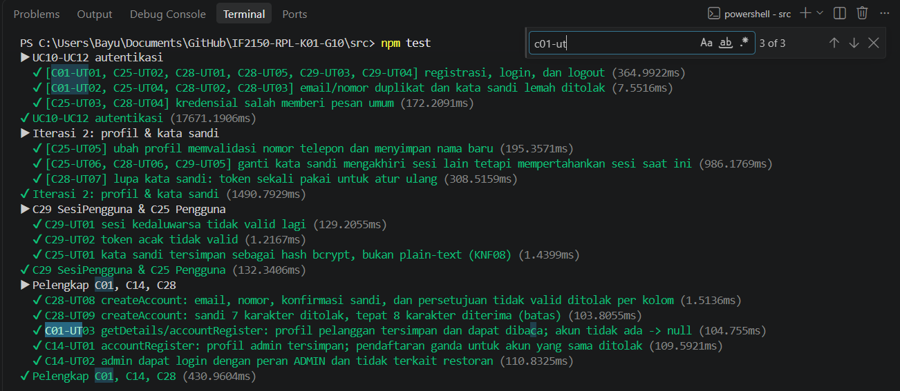 |
| C02-UT01 – C02-UT10 (Restoran, 10 test case) | 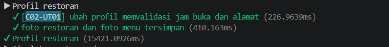  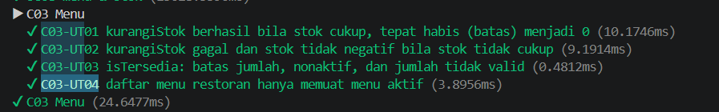 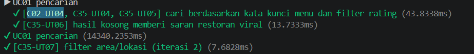    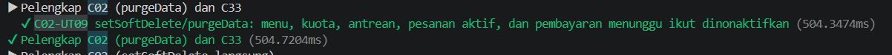 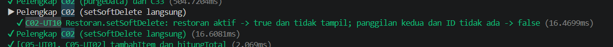 |
| C03-UT01 – C03-UT11 (Menu) | 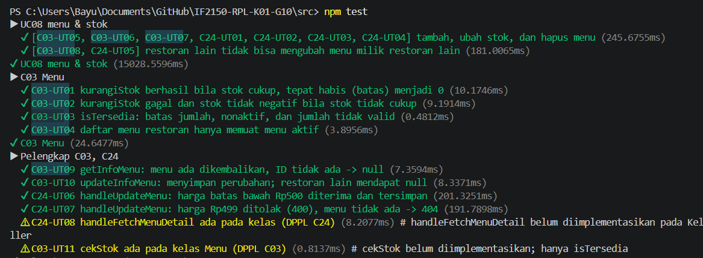 |
| C04-UT01 – C04-UT08 (Antrean) |  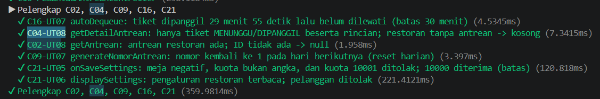|
| C05-UT01 – C05-UT11 (Keranjang) | 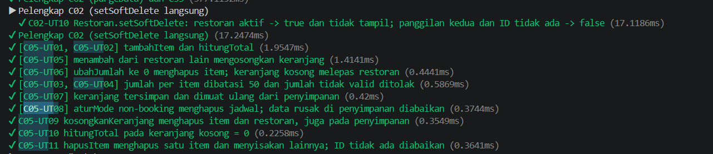 |
| C06-UT01 – C06-UT12 (Pesanan) |  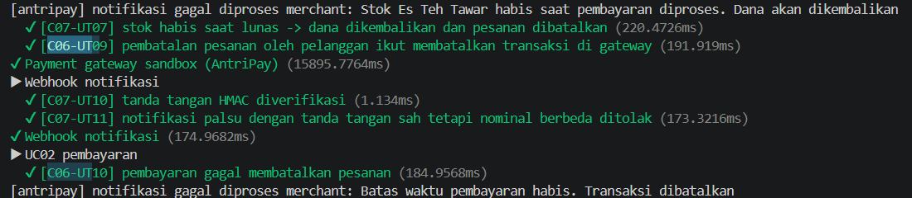 |
| C07-UT01 – C07-UT13 (MetodePembayaranController) | 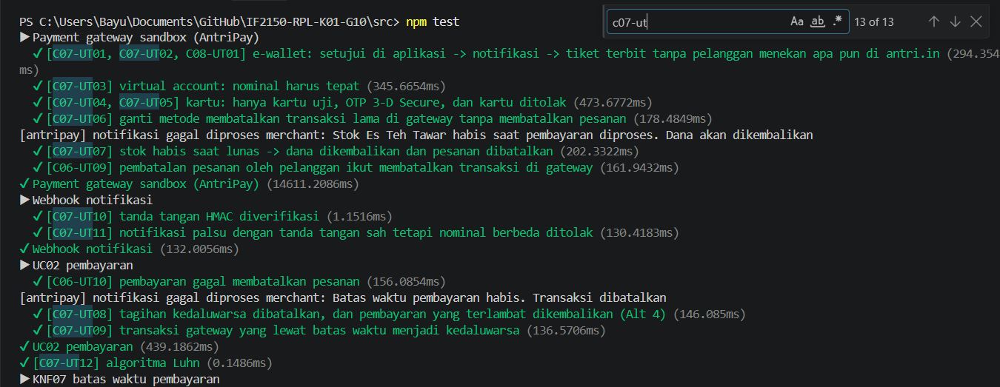  |
| C08-UT01 – C08-UT03 (RiwayatTransaksi) |  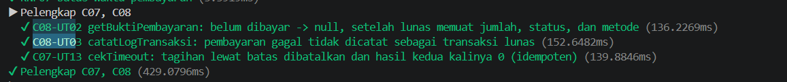 |
| C09-UT01 – C09-UT07 (TiketAntrean) | 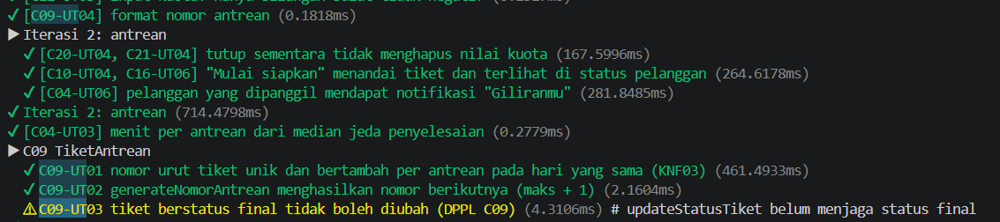 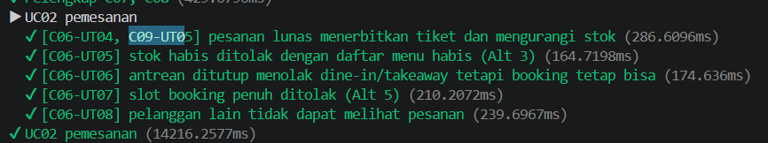   |
| C10-UT01 – C10-UT04 (PemantauAntreanController) | 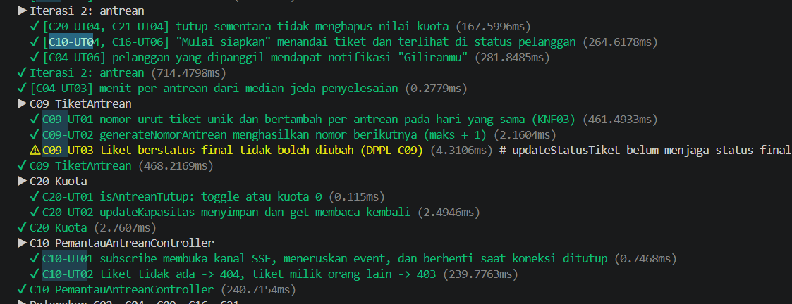  |
| C12-UT01 – C12-UT10 (PengajuanMitraController) | 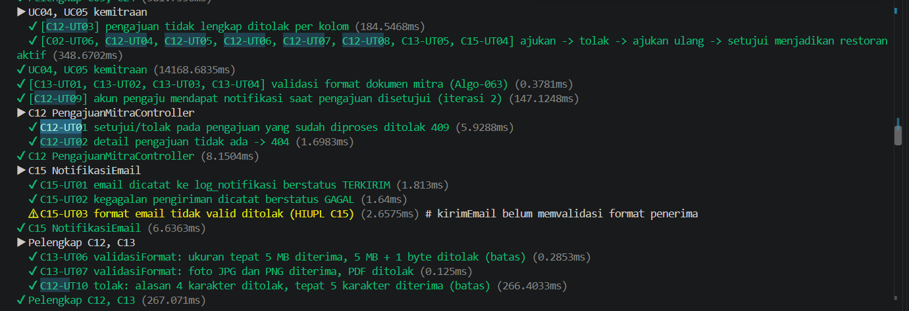 |
| C13-UT01 – C13-UT07 (DokumenVerifikasi) | 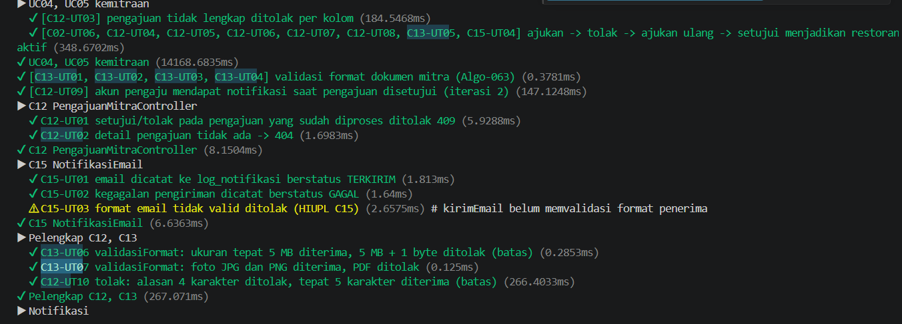 |
| C14-UT01 – C14-UT02 (Admin) |  |
| C15-UT01 – C15-UT04 (NotifikasiEmail) | 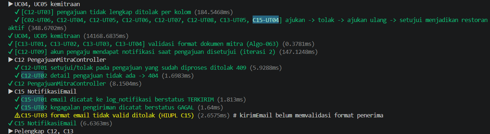 |
| C16-UT01 – C16-UT07 (KelolaAntreanController) |   |
| C20-UT01 – C20-UT05 (Kuota) | 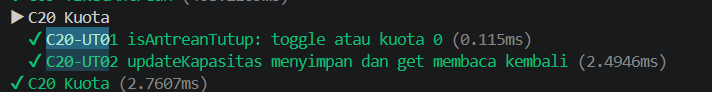  |
| C21-UT01 – C21-UT06 (PengaturanKuotaController) | 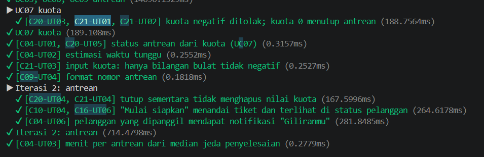 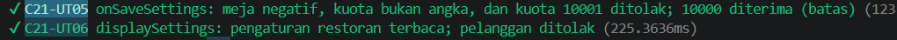 |
| *INT-TC01* | *[Sisipkan bukti pengujian integrasi]* |
| *UC01-TC01* | *[Sisipkan tangkapan layar UC01-TC01 sesuai prosedur pengujian]* |
| *UC01-TC02* | *[Sisipkan tangkapan layar UC01-TC02 sesuai prosedur pengujian]* |
| *KNF01-TC01* | *[Sisipkan bukti pengukuran parameter KNF01-TC01]* |
| *...* | *...* |

 

---

# BAB 5: Traceability

Petakan setiap KF ke KNF, use case, kelas perancangan, file implementasi, dan test case. Tabel traceability berikut akan menjadi sarana verifikasi KF. Setiap KF memiliki minimal satu test case dan dinyatakan terpenuhi apabila **seluruh** test case terkaitnya berkesimpulan `Pass`. KF yang tidak diimplementasikan tetap dicantumkan beserta alasannya.

Tabel 5.1. Matriks Kerunutan KF terhadap Implementasi dan Pengujian

| KF ID | KNF Terkait | Use Case ID | Kelas Terkait | Implementasi File Terkait | Test Case (UC) | Test Case (Unit/Integrasi/KNF) |
| :--- | :--- | :--- | :--- | :--- | :--- | :--- |
| *KF05* | *KNF01* | *UC03* | *C02 - Pesanan* | *`src/...`* | *UC03-TC01* | *C02-UT05, INT-TC04, KNF01-TC01* |
| *KF01* | *-* | *UC01 UC02* | *[C01 - Nama kelas] [C02 - Nama kelas]* | *[path/ke/file1] [path/ke/file2]* | *UC01-TC01, UC01-TC02 UC02-TC01* | *-* |
| *KF02* | *[KNFXX atau -]* | *[UCXX]* | *[CXX - Nama kelas]* | *[path/ke/file]* | *[UCXX-TCYY]* | *[CXX-UTYY, INT-TCYY, KNFXX-TCYY atau -]* |
| *KFXX* | *-* | *[UCXX atau -]* | *[CXX - Nama kelas atau -]* | *Tidak diimplementasikan: [alasan]* | *-* | *-* |
| *...* | *...* | *...* | *...* | *...* | *...* | *...* |

Tabel 5.2. Matriks Kerunutan KNF terhadap Pengujian

| ID KNF | Parameter | KF/UC Terkait | Test Case |
| :--- | :--- | :--- | :--- |
| KNF01 | Availability | KF01, KF02 / UC01 | KNF01-TC01 |
| KNF02 | Response time | KF01, KF02 / UC01 | KNF02-TC01 |
| KNF03 | Reliability | KF03, KF10 / UC02, UC03 | KNF03-TC01 |
| KNF04 | Ergonomy | KF03 / UC02, UC03 | KNF04-TC01 |
| KNF05 | Availability | KF03 / UC03 | KNF05-TC01 |
| KNF06 | Reliability | KF08 / UC02 | KNF06-TC01 |
| KNF07 | Availability | KF11 / UC02 | KNF07-TC01 |
| KNF08 | Security | KF11 / UC02 | KNF08-TC01 |
| KNF09 | Response time | KF12 / UC02 | KNF09-TC01 |
| KNF10 | Reliability | KF12 / UC02 | KNF10-TC01 |
| KNF11 | Availability | KF14 / UC04 | KNF11-TC01 |
| KNF12 | Response time | KF15 / UC05 | KNF12-TC01 |
| KNF13 | Ergonomy | KF01, KF03 / UC01, UC02, UC03 | KNF13-TC01 |
| KNF14 | Reliability | KF12 / UC02 | KNF14-TC01 |
