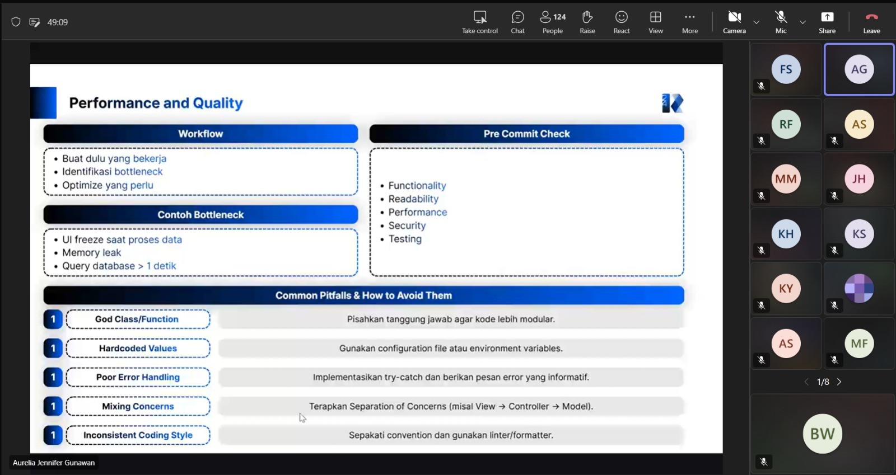

# Form Asistensi

## Tugas Besar IF2150 - Rekayasa Perangkat Lunak

| Informasi | Keterangan |
| --- | --- |
| **Hari** | *Senin* |
| **Tanggal** | *2/11/2026* |
| **Kelas** | *K01* |
| **Nomor Kelompok** | *G10*  |
| **Nama Kelompok** | *Ducklings*  |
| **Nama Perangkat Lunak** | *antri.in*  |
| **Dokumen** | *K01_G10_DPPL2.md*  |

### Anggota Kelompok

| NIM | Nama |
| --- | --- |
| *13525145* | *Muhammad Nur Fikri Hariyawan* |
| *13525085* | *Bayu Palamarta Wirawan* |
| *13525133* | *Chatima Anandakhorita* |
| *13525148* | *Athallah Nanda Andita* |
| *13525091* | *Muhammad Fauzi Muharam* |

### Catatan

| Catatan |
| --- |
| 1. *Pada readme projek, tunjukkan cara run projek, cara mengujinya, lalu alat yang digunakan seperti docker, npm, dan versinya.*  |
| 2. *Issue adalah masalah yang ingin ditangani. Dari issue, dapat dibaut branch untuk menangani masalah tersebut.* |
| 3. *Jika implementasi tidak selesai sebelum deadline, coba saja kerjakan dulu aja dengan berpatokan deadlinenya hari rabu tanggal 11. Kalau ada kendala mendekati deadline, komunikasiin aja sama asistensi.* |
| 4. *Untuk mengejar target deadline, prioritaskan fitur-fitur utama pada Kebutuhan Fungsional terlebih dahulu.* |

**Notes for this section:**  
*Catatan dapat dituliskan dalam bentuk paragraf atau poin-poin, disesuaikan saja.* 

## Dokumentasi

<!--  -->

  

  <i>Gambar 1. Dokumentasi kegiatan asistensi.</i>

